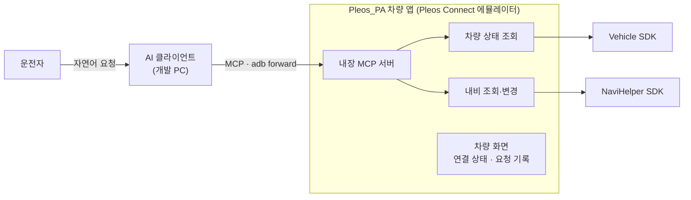

# Pleos_PA

> 주로 사용하는 AI에서 내비게이션을 설정하고 차량 상태를 확인하며, 쌓인 주행기록까지 AI로 돌아볼 수 있게 하는 연결 서비스.

Pleos Connect 차량 앱에 MCP 서버를 내장해, ChatGPT·Claude 같은 AI가 차량 상태를 조회하고 순정 내비의 목적지·경유지를 설정하게 하는 Android 앱이다. 현대자동차그룹 차량용 앱 개발 공모전 출품작이며 2인 팀이 만든다.

위의 한 줄 소개는 목표 제품이다. 지금 구현된 범위는 [지금 되는 것](#지금-되는-것features)에, 나머지는 [계획](#계획plan)에 있다.

| 항목 | 내용 |
| --- | --- |
| 앱 이름 | Pleos_PA |
| 테스트 환경 | Pleos Connect 에뮬레이터 `Pleos_Connect_v2.1.0` (API 34) |
| 화면 규격 | 2560×1440, 160dpi, 가로 |
| 실행 방법 | [데모 실행](#데모-실행start) |
| APK 위치 | [릴리스](#릴리스) |

## 지금 되는 것(Features)

- **차량 상태 조회**: 문, 창문, 배터리·연료, 공조, 타이어, 등화 등을 읽는 도구 20개. 값과 수신 시각, 상태(정상, 미지원, 권한 없음, 시간 초과)를 함께 돌려준다.
- **내비 조회**: 현재 목적지, 남은 시간·거리, 경유지를 읽는다.
- **내비 변경**: 목적지를 설정하고 경유지를 추가·삭제한다. 설정한 뒤 다시 조회해 실제로 반영됐는지 확인하고, 주행 규제 중에는 변경을 막는다.
- **차량 화면**: 연결을 시작·중지하고, 연결 상태와 요청 기록을 보여 준다.
- **연결**: 표준 MCP(Streamable HTTP)를 쓴다. 별도 서버 없이 에뮬레이터와 PC만으로 실행한다.

## 데모 실행(Start)

심사위원과 평가자가 직접 실행해 볼 수 있는 절차다.

### 테스트 환경과 필요한 설정

| 항목 | 기준 |
| --- | --- |
| 에뮬레이터 | Pleos Connect 에뮬레이터 `Pleos_Connect_v2.1.0` (API 34) |
| 화면 규격 | 2560×1440, 160dpi, 가로. 에뮬레이터의 기본 주 화면이며 따로 바꿀 설정은 없다 |
| PC | `adb`를 쓸 수 있는 개발 PC |
| AI 클라이언트 | MCP 서버를 URL로 등록할 수 있는 클라이언트. 팀이 확인한 범위는 아래 [확인한 범위와 한계](#확인한-범위와-한계)에 있다 |
| APK | 아래 [릴리스](#릴리스) 절의 APK, 또는 [소스에서 빌드](#소스에서-빌드)한 APK |

### 1. 앱 설치와 연결 시작

에뮬레이터를 켠 뒤 APK를 설치한다. 기기가 여러 대면 `-s`로 하나를 지정한다.

```powershell
adb devices
adb -s <기기 serial> install -r <APK 파일>
```

에뮬레이터에서 **Pleos_pa** 앱을 열고 **시작**을 누른다. 화면에 "연결됨. 앱의 MCP 서버가 요청을 받을 수 있습니다."가 나오면 준비가 끝난 것이다. 알림 권한을 허용하면 알림에서도 연결을 중지·재개할 수 있다.

### 2. PC와 연결

```powershell
adb -s <기기 serial> forward --no-rebind tcp:18766 tcp:18766
```

`tcp:18766`을 이미 다른 작업이 쓰고 있으면 이 명령이 실패한다. 덮어쓰지 말고 그 작업을 먼저 끝낸다.

### 3. AI 클라이언트에 등록

MCP 서버 주소는 `http://127.0.0.1:18766/mcp`다. 토큰이나 환경 변수는 필요 없다.

**Codex CLI** — `~/.codex/config.toml`에 추가한다.

```toml
[mcp_servers.pleos-pa-vehicle]
url = "http://127.0.0.1:18766/mcp"
```

**Claude Code CLI** — 아래 내용의 JSON 파일을 만들고 `claude --mcp-config <파일>`로 실행한다.

```json
{"mcpServers":{"pleos-pa-vehicle":{"type":"http","url":"http://127.0.0.1:18766/mcp"}}}
```

### 4. 물어보기

| 해 볼 요청 | 일어나는 일 |
| --- | --- |
| "차 문이 열려 있는지 확인해 줘" | `get_door_status`가 문 상태를 읽는다 |
| "배터리 잔량 알려 줘" | `get_energy_level`이 잔량을 읽는다 |
| "판교역으로 안내해 줘" | 장소를 찾고 목적지를 설정한 뒤, 다시 조회해 반영을 확인한다. 에뮬레이터의 내비 화면이 바뀐다 |
| "지금 목적지와 남은 시간 알려 줘" | `get_navigation_destination`이 목적지와 남은 시간·거리를 읽는다 |
| "가는 길에 코엑스에 들르게 해 줘" | 경유지를 추가하고 다시 조회해 확인한다. 목적지가 설정돼 있어야 한다 |

차량 값이 실제 값인지 확인하려면 에뮬레이터의 Virtual Console에서 문이나 배터리 값을 바꾼 뒤 다시 물어본다. AI의 답이 바꾼 값을 따라오면 된다. 앱의 **요청 기록**에는 받은 요청과 결과, 수신 시각이 남는다.

목적지와 경유지로 쓸 수 있는 장소는 서울역, 판교역, 현대백화점 판교점, 코엑스 네 곳이다. 이 요청들은 에뮬레이터의 내비 상태를 실제로 바꾼다. 비대화형 `codex exec`처럼 도구 승인을 묻지 않는 실행 방식은 변경 도구를 클라이언트 쪽에서 거절할 수 있다. 그때는 `-c mcp_servers.pleos-pa-vehicle.default_tools_approval_mode=approve`를 붙인다.

### 5. 끝내기

앱에서 **중지**를 누르고 forward를 지운다. 인증이 없는 개발용 연결이므로 쓰지 않을 때는 꺼 둔다.

```powershell
adb -s <기기 serial> forward --remove tcp:18766
```

### 잘 안 될 때

| 증상 | 확인할 것 |
| --- | --- |
| AI가 서버에 연결하지 못한다 | 앱 화면이 "연결됨"인지, `adb forward`가 살아 있는지 본다. 앱을 다시 실행하면 중지 상태로 시작하므로 **시작**을 다시 눌러야 한다 |
| `BUSY`가 돌아온다 | 한 번에 한 요청만 처리한다. 앞선 요청이 끝난 뒤 다시 요청한다 |
| 목적지 설정이 차단된다 | 주행 규제 중이거나 규제 상태를 확인하지 못하면 내비 변경을 막는다. 에뮬레이터를 주차(P) 상태로 둔다 |
| 장소를 찾지 못한다 | 서울역, 판교역, 현대백화점 판교점, 코엑스가 아닌 장소는 찾지 못한다 |

## 구조(Structure)



대화와 판단은 AI가 맡고, 앱은 SDK 실행과 결과 확인만 맡는다. 앱은 차량이 준 값만 돌려주며, 조회에 실패하면 값을 추측하지 않고 실패 상태를 그대로 돌려준다.

| 구성 | 역할 |
| --- | --- |
| 내장 MCP 서버 | AI의 도구 호출을 받아 SDK를 실행하고 결과를 돌려준다. 앱 화면이 백그라운드에 있어도 응답한다 |
| 차량 상태 조회 | Vehicle SDK의 조회 결과를 값·수신 시각·상태(정상, 미지원, 권한 없음, 시간 초과)로 구분해 돌려준다 |
| 내비 조회·변경 | NaviHelper SDK로 목적지와 경유지를 설정한 뒤 다시 조회해 실제로 반영됐는지 확인한다. 주행 규제 중에는 변경을 막는다 |
| 차량 화면 | 연결 상태와 요청 기록을 보여 주고 연결을 시작·중지한다 |

1차 제출은 개발 PC의 AI 클라이언트가 `adb forward`로 차량 앱에 연결한다. 별도 서버가 필요 없어 에뮬레이터와 PC만으로 재현할 수 있다. 운전자가 PC 없이 휴대폰의 AI 앱으로 연결하는 경로는 아직 없으며 [계획](#계획plan)의 2차 PT 전 범위다.

## 제공하는 도구(Scope)

AI가 호출할 수 있는 도구는 26개다. 모두 에뮬레이터에서 실행해 확인한 것만 내놓는다.

| 구분 | 도구 |
| --- | --- |
| 차량 상태 조회 (20개) | `get_door_status`, `get_window_status`, `get_energy_level`, `get_front_left_door_position`, `get_brake_status`, `get_display_units`, `get_glove_box_status`, `get_driving_mode_status`, `get_ev_status`, `get_hvac_status`, `get_light_status`, `get_trip_status`, `get_safety_status`, `get_seat_status`, `get_side_mirror_status`, `get_steering_wheel_status`, `get_tire_status`, `get_turn_signal_status`, `get_window_detail_status`, `get_wiper_status` |
| 내비 조회 | `get_navigation_destination`(현재 목적지와 남은 시간·거리), `get_navigation_waypoints`(경유지) |
| 내비 변경 | `find_navigation_place`(장소 찾기), `set_navigation_destination`(목적지 설정), `add_navigation_waypoint`, `remove_navigation_waypoint` |

목적지와 경유지로 쓸 수 있는 장소는 지금 **서울역, 판교역, 현대백화점 판교점, 코엑스** 네 곳이다. SDK에 장소 검색 기능이 없어, 에뮬레이터에서 좌표를 검증한 고정 목록을 쓴다. 일반 장소 검색은 [계획](#계획plan)의 출시 준비 단계에 있다.

도구의 입력·출력·오류 의미는 [차량 조회 계약](contracts/vehicle-read/CONTRACT.md)과 [내비 계약](contracts/navigation/CONTRACT.md)에 있다.

## 쓰는 SDK와 권한

| SDK | 버전 | 쓰는 범위 |
| --- | --- | --- |
| Pleos Vehicle SDK | 2.3.2 | 차량 상태 조회. 제어 API는 쓰지 않는다 |
| Pleos NaviHelper SDK | 3.0.5 | `getDestinationInfo`, `requestRoute`, `getWaypointInfo`, `addWaypoint`, `removeWaypoint` |
| MCP Kotlin SDK / Ktor | 0.16.0 / 3.5.2 | 앱 안의 MCP 서버 |

선언한 Pleos 권한은 도구가 쓰는 조회 권한(`CAR_CLIMATE`, `CAR_DOORS`, `CAR_DRIVE`, `CAR_ENERGY`, `CAR_INFO`, `CAR_LIGHTS`, `CAR_MIRRORS`, `CAR_SAFETY`, `CAR_SEATS`, `CAR_WINDOWS`)과 내비 권한(`NAVI_ROUTE`, `NAVI_ROUTE_SEARCH`)이다.

## 확인한 범위와 한계

**확인한 것**

- Pleos Connect 에뮬레이터 `Pleos_Connect_v2.1.0`(API 34)에서 26개 도구를 실행했다. 조회 값은 Virtual Console에서 설정한 값과 대조했고, 내비 변경은 다시 조회해 반영을 확인했다. 도구별 근거는 두 계약 문서에 있다.
- Codex CLI로 실제 AI 호출을 확인했다. 목적지 설정과 조회의 처음부터 끝까지도 Codex CLI로 확인했다.
- Claude Code CLI는 서버 연결과 도구 목록이 보이는 것까지만 확인했다. 도구 호출은 확인하지 못했다.

**하지 않았거나 되지 않는 것**

- 실차에서는 확인하지 않았다. 에뮬레이터의 결과가 실차에서도 같다고 보장하지 않는다.
- PC 없이는 연결할 수 없다. ChatGPT 웹처럼 공개 HTTPS 주소가 필요한 클라이언트는 이 연결 방식으로 쓸 수 없다.
- 연결에 인증이 없다. 서버는 기기 안에서만 열리고 PC에서도 `adb forward`로만 닿지만, 서버가 열려 있는 동안에는 같은 기기의 다른 앱과 PC의 다른 프로그램도 차량 조회 값을 읽을 수 있다. 차량 식별 번호(VIN)와 차량 제어는 내놓지 않는다.
- 화면의 "연결됨"은 서버가 요청을 받을 준비가 됐다는 뜻이며, AI가 연결돼 있다는 뜻은 아니다.
- 내비 변경을 되돌리는 기능은 없다. 연결을 중지해도 이미 설정한 목적지는 그대로다.
- 요청 기록은 앱이 켜져 있는 동안 메모리에만 있다. 앱을 다시 실행하면 사라진다.
- 일정 확인과 메시지 전송은 이 앱의 기능이 아니다. AI에 따로 연결한 서비스가 맡으며, 약속 장소로 출발하는 흐름의 검수 절차는 [약속 출발 검수](tools/departure-check/README.md)에 있다.
- Gleo AI 연동은 하지 않는다.

## 계획(Plan)

지금 구현된 것은 아래 표의 1차 제출 범위이고, 나머지 단계는 계획이다.

| 단계 | 범위 | 상태 |
| --- | --- | --- |
| 1차 제출 | 차량 앱에 내장한 MCP 서버, 차량 상태 조회 도구 20개, 내비 도구 6개 | 구현 |
| 2차 PT 전 | PC 없이 연결하는 중계 서버, 차량·계정 연결(일회용 코드·QR 코드), 자동 시작, 마지막 차량 정보 보관, 주행 요약·이동 경로 기록, 기록 조회 도구, ChatGPT·Claude용 플러그인 | 계획. 저장소에 없다 |
| 출시 준비 | 일반 장소 검색, 날짜별 경로 지도, 실차 검증, 앱 마켓과 AI 앱 디렉터리 등록 | 계획 |
| 확장 | 사용자 승인 기반 차량 기능 제어 | 계획. 현재 앱에 제어 기능이 없다 |

## 릴리스

공모전 제출 규정에 따라 실행 가능한 release APK를 저장소의 `apk/` 폴더에 `팀명_앱이름_release.apk` 이름으로 둔다. 1차 제출 버전을 확정하면 아래를 채운다.

| 항목 | 내용 |
| --- | --- |
| APK 위치 | 미정 (`apk/` 폴더. 용량이 넘으면 GitHub Releases) |
| 버전(tag) | 미정 |
| APK를 빌드한 커밋 | 미정 |
| 빌드 종류와 서명 | 미정 |
| APK SHA-256 | 미정 |
| 빌드한 날 | 미정 |

## 소스에서 빌드

| 항목 | 기준 |
| --- | --- |
| JDK | 25 |
| Android SDK | compile·target 37, min 28, Build Tools 36.0.0 |
| Gradle / AGP / Kotlin | Wrapper 9.6.0 / 9.5.1 / 2.4.21 |
| Android Studio | Rabbit 2 (2026.2.2) 이상 |

Android SDK 경로를 `local.properties`나 `ANDROID_HOME`으로 지정한 뒤 빌드한다. Unix에서는 `.\gradlew.bat` 대신 `bash ./gradlew`를 쓴다.

```powershell
.\gradlew.bat :app:assembleDebug
```

APK는 `app\build\outputs\apk\debug\app-debug.apk`에 만들어진다.

## 개발에 참여한다면

협업 흐름, 검증 명령, 문서 위치, 앱의 세부 동작은 [AGENTS.md](AGENTS.md)에서 시작한다. 이 README는 프로젝트를 처음 보는 사람을 위한 소개이며, 개발용 세부 내용은 그쪽에 둔다.
