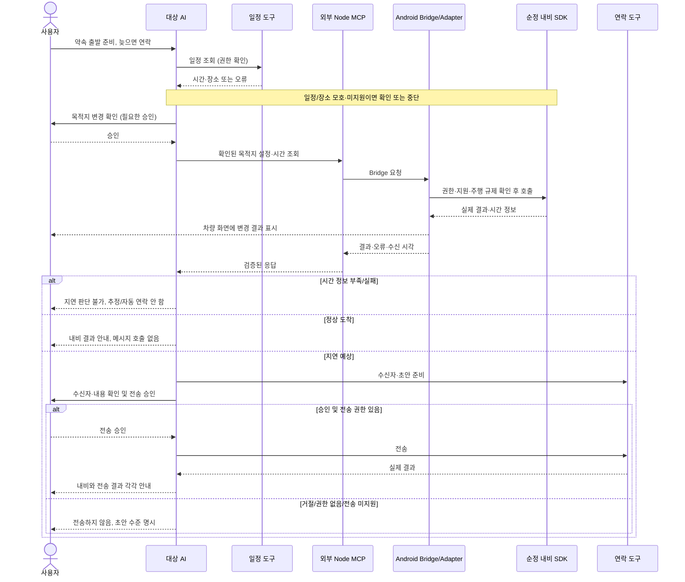

# 약속에 맞춰 출발하기 (목표 시나리오, 미구현)

SDK 목적지 설정·ETA 및 동일 AI 환경(ChatGPT·Claude)의 일정/메시지 연동이 지원되는지 먼저 검증한다 (COM-8, COM-10). 도구 결합이 확인된 AI로 판정한다. Gleo 연동은 사용하지 않는다.

목적지 변경 승인이 거절되면 SDK 변경 호출을 하지 않는다. AI 프롬프트만을 승인 강제 장치로 보지 않으며, 승인 검증이 성립하지 않으면 변경 도구를 제외한다. 변경 요청 후 timeout은 결과 불명으로 표시하고 자동 재시도하지 않는다.
ETA/약속 시간은 시간대·기준 시각·단위를 확인해 비교한다.

## 인수 기준

정상·지연 분기를 각각 증명해야 통합 경험 완료로 판정한다. 증명하지 못하면 단일 통합 작업의 성공으로만 기록한다. 기능 기준은 [요구사항](https://linear.app/wonsub/document/요구사항-정의서-1b7e6fcd5721) 4.7, 횟수와 시간 목표는 6.2를 따른다.

- 정상 도착: 일정/내비 결과 안내, 메시지 도구 호출 없음.
- 지연 도착: 수신자·초안 확인 → 승인/권한 후 전송 → 실제 결과 안내.
- 거절·권한 없음·일정/장소 불명·ETA 미지원·연결 실패: 추가 변경/전송을 하지 않고 실패나 초안 수준을 표시.

전체 시행을 기록하고 성공 사례만 선별하지 않는다. commit/APK, SDK·Emulator·AI 제품과 버전, 입력, 실제 결과, 소요 시간, 판정을 남기고 비밀과 개인정보는 제거한다. 모의 응답과 실제 SDK 동작을 구분한다.
