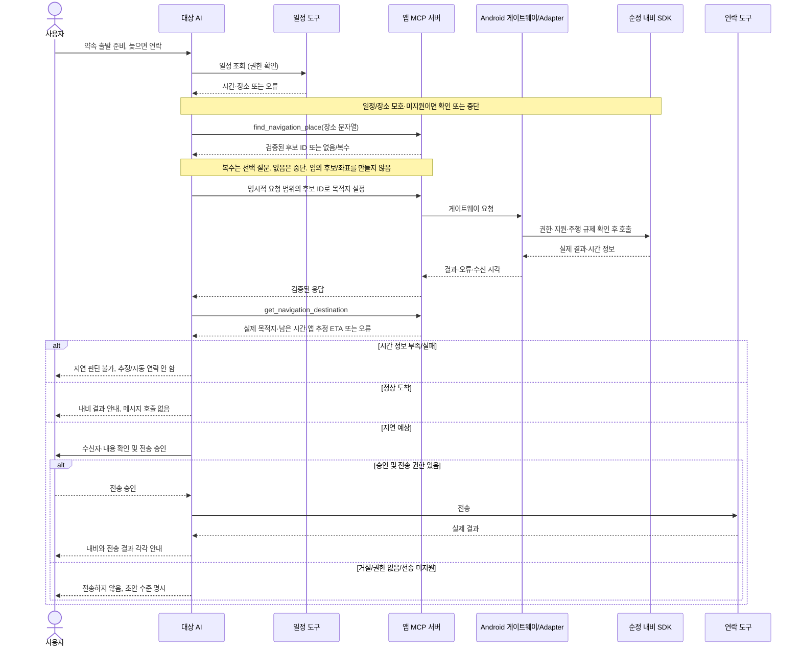

# 약속에 맞춰 출발하기

기준 기획서 4.2 "약속 장소로 출발하기"의 런타임 흐름이다. 차량 쪽 도구(장소 찾기, 목적지 설정, 목적지 조회)는 구현돼 있고, 일정과 메시지는 AI에 연결된 외부 서비스가 맡는다. 연결은 개발 PC의 `adb forward`이며, 중계 서버를 거치는 흐름은 2차 PT 전 범위로 아직 없다. 검수 결과는 Linear COM-28에서 관리한다.

SDK 목적지 설정·ETA 및 동일 AI 환경의 일정/메시지 연동을 조합해 검수한다. 우선 경로는 COM-10에서 도구 결합을 확인한 Codex PC 채팅이며 Notion 테스트 일정과 실제 제품 MCP를 사용한다. 내비 단독 E2E는 약속 출발의 정상/지연 두 분기 증거를 대신하지 않는다. Gleo 연동은 사용하지 않는다. 재현 절차와 시간 비교 보조 도구는 [departure-check](../../../tools/departure-check/README.md)에 있다.

별도 내비 재승인은 현행 요구사항에서 폐기됐다. 명시적인 내비 요청과 유효한 후보·연결·지원·주행 규제·현재 상태 검사를 실행 조건으로 사용한다. 검수의 차량 변경 실행 목록 승인은 제품의 별도 재승인 UI를 추가하는 뜻이 아니다. 변경 요청 후 timeout은 결과 불명으로 표시하고 자동 재시도하지 않는다.

외부 메시지는 대상 워크스페이스·채널/수신자·최종 본문에 대한 명시 승인 뒤에만 전송한다. 거절/취소/대상·본문 변경 후 새 승인 전 전송0건, 실패/결과 불명 후 자동 재전송0건이다. 이 승인 경계는 외부 서비스/AI 환경에서 검증하며 차량 MCP나 시간 비교 보조 도구가 강제한다고 설명하지 않는다.

ETA/약속 시간은 명시적 시간대·기준 시각·단위를 확인해 비교한다. 앱 ETA는 수신 시각에 남은 초를 더한 추정값이다. 정상 예상은 메시지 도구를 호출하지 않고, 지연 예상만 초안을 준비한다. 일정·장소·시간이 불명확하거나 응답이 불완전하면 중단/확인하며, 이미 보낸 내비 요청이 취소·복원됐다고 말하지 않는다. 일정·메일·대화 원문은 차량 앱에 전달하지 않는다.

## 인수 기준

정상·지연 분기를 각각 증명해야 통합 경험 완료로 판정한다. 증명하지 못하면 단일 통합 작업의 성공으로만 기록한다. 기능 기준은 [요구사항](https://linear.app/wonsub/document/요구사항-정의서-1b7e6fcd5721) 4.7, 횟수와 시간 목표는 6.2를 따른다.

- 정상 도착: 일정/내비 결과 안내, 메시지 도구 호출 없음.
- 지연 도착: 수신자·초안 확인 → 승인/권한 후 전송 → 실제 결과 안내.
- 거절·권한 없음·일정/장소 불명·ETA 미지원·연결 실패: 추가 변경/전송을 하지 않고 실패나 초안 수준을 표시.

전체 시행을 기록하고 성공 사례만 선별하지 않는다. commit/APK, SDK·Emulator·AI 제품과 버전, 입력, 실제 결과, 소요 시간, 판정을 남기고 비밀과 개인정보는 제거한다. 모의 응답과 실제 SDK 동작을 구분한다.
