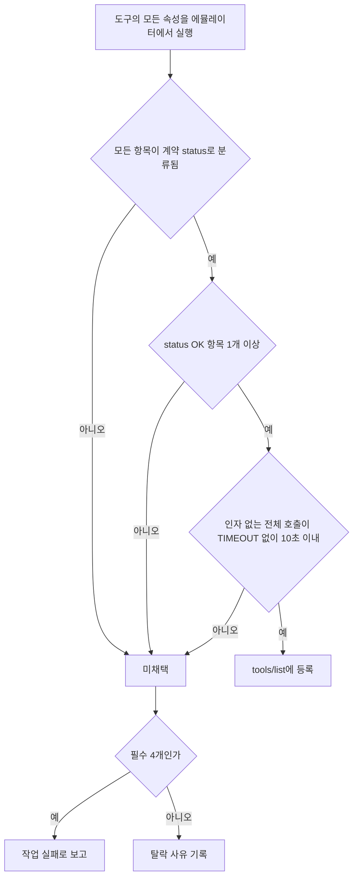
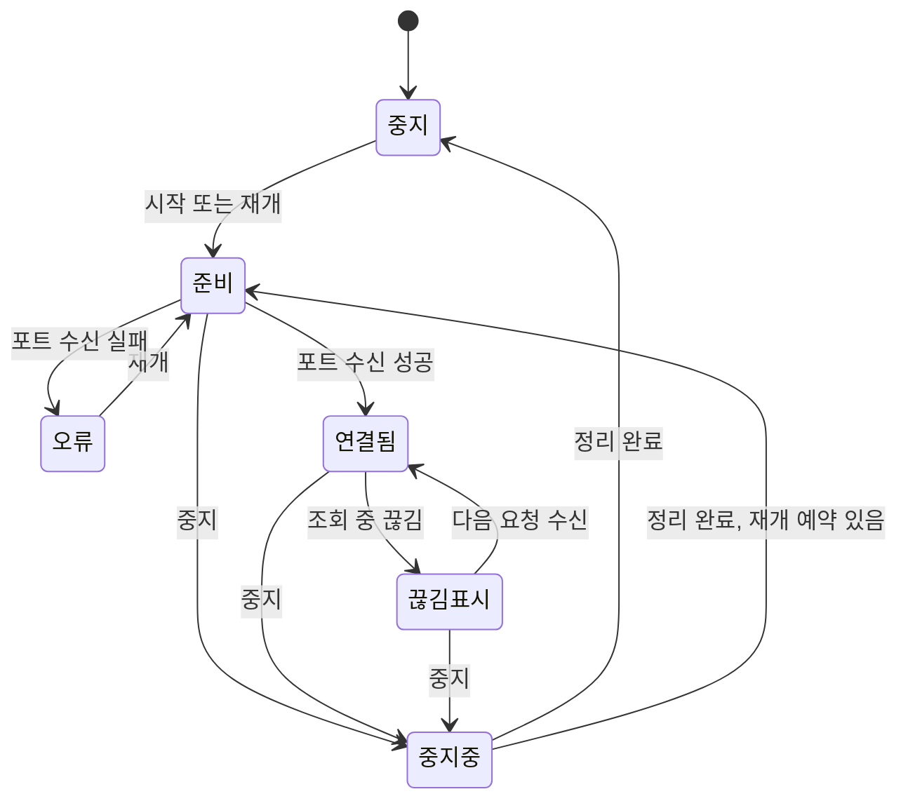
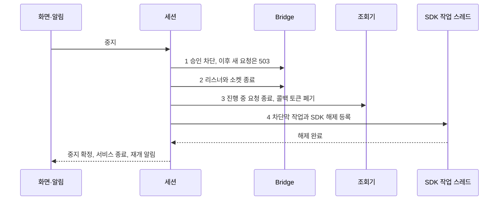
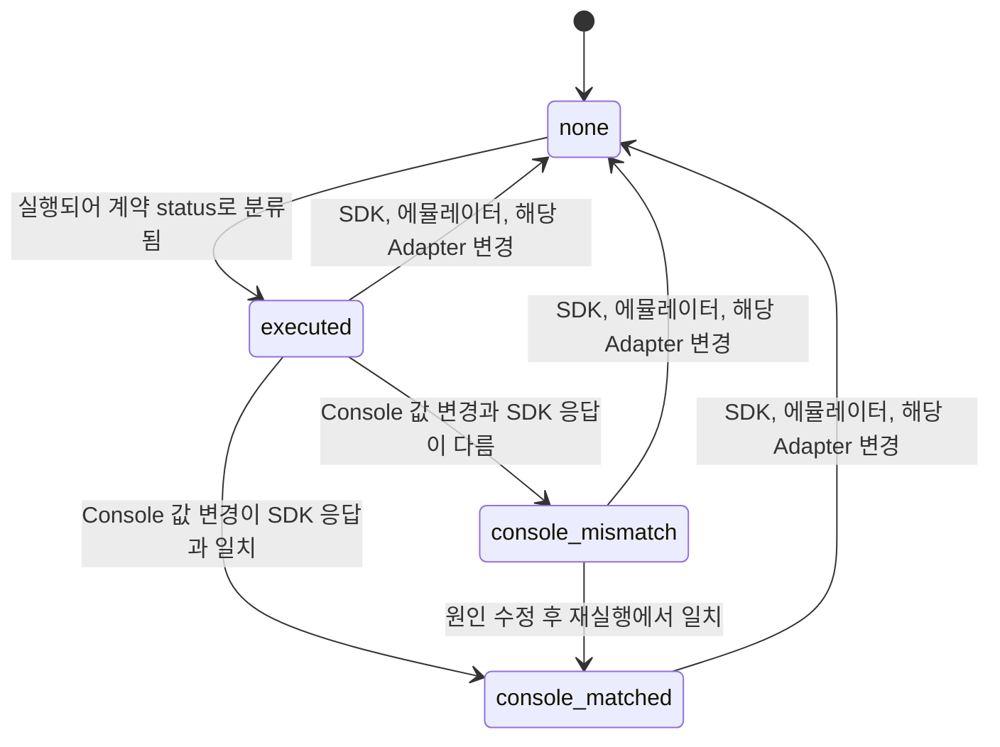

# 차량 조회와 연결 제어 - Plan

## Goal Capsule

- **Objective:** 사용자가 ChatGPT·Claude에서 Pleos 에뮬레이터의 실제 차량 값을 조회하고, 앱 화면과 알림에서 그 연결을 중지·재개한다.
- **Means:** COM-18(Service·Bridge), COM-20(Adapter), COM-23(도구), COM-26(E2E)을 PoC `0d288c8`에서 기능 단위로 선택 이전하고 신규 계약대로 구현한다.
- **Product authority:** 요구와 우선순위의 원천은 Linear COM-1·COM-2와 요구사항 정의서다. 공통 규칙의 원천은 `contracts/vehicle-read/CONTRACT.md`이며, 계약 변경은 상대 개발자와 합의한다.
- **Open blockers:** 구현 착수를 막는 항목은 없다. 아래 항목은 표시한 단계를 막는다.
  - B1. 검증 상태 어휘와 도구 채택 기록(KTD4)은 계약 변경이라 상대 개발자 합의가 필요하다. U5와 U10의 병합을 막는다. `SMART_GLASS_CONFIG`의 처리(KTD5)도 함께 합의한다.
  - B2. 중지 때 진행 중이던 요청의 응답이 미정이다. 계약의 중지 순서대로면 소켓이 먼저 닫혀 Node는 `ANDROID_UNREACHABLE`을 받고, FR-CON-04는 "중지 오류"를 요구한다. 기본 구현은 계약 순서를 따르며(KTD3), COM-18 병합 전에 상대 개발자와 해석을 합의한다.
  - B3. PoC 저장소에 LICENSE 파일이 없다. 저장소 소유자의 재사용 확인을 기록해야 COM-18을 병합할 수 있다(R11).
  - B4. Linear 수정이 남았다. COM-20의 범위 반영은 권한 정책에 막혔다. COM-23·COM-26은 1차 수정만 끝났고, COM-18·COM-20·COM-23·COM-26과 SDK 지원 기능표에 이번 보완 내용이 없다. 해당 이슈의 완료 판정을 막는다.
  - B5. AI 호출 실행자와 일시가 배정되지 않았다(요구사항 OQ-12). U11 실행을 막는다.
- **Stop conditions:** 필수 4개가 R14나 R19를 만족하지 못할 때, R30의 조건이 관찰될 때, Pleos 에뮬레이터에서 알림의 중지·재개 동작을 쓸 수 없을 때 멈추고 사실과 제안을 나눠 보고한다.
- **사람이 끝낼 일:** ChatGPT·Claude 호출 실행(COM-26), 상대 개발자 승인, 병합 지시.

---

## Product Contract

### Summary

Android 앱에 Foreground Service·Bridge와 최소 제어 화면을 넣고, Adapter는 카탈로그의 공개 조회 97개 속성을, MCP 서버는 도구 22개를 구현한다.
모든 속성을 에뮬레이터에서 실행한 결과로 도구를 채택해 `tools/list`에 올린다.
필수 4개는 기존 E2E 기준으로, 채택된 후보 도구는 두 AI에서 각 1회 호출로 확인한다.

### Problem Frame

`main`의 앱에는 Activity, Service, Bridge, Adapter가 없고 MCP 서버의 `tools/list`는 비어 있다.
COM-16은 97개 속성과 22개 도구를 계약으로 고정했지만 카탈로그의 `verification`은 전부 `none`이다.
SDK 실측은 실패 분류 2건뿐이고, PoC의 성공 기록은 신규 앱의 증거가 아니다.

COM-23의 제목과 수용 기준은 도구 4개 기준으로 남아 있고, 확장 내용은 "계약 합의 전 제안"으로 덧붙어 있다.
COM-26도 도구 4개만 언급한다. 이대로면 후보 18개의 완료 여부를 판정할 기준이 없다.

### Key Decisions

- **범위는 97개 속성과 22개 도구다.** COM-16의 계약과 ADR-0004를 그대로 구현한다. Governs R12, R18. (session-settled: user-directed — chosen over COM-23을 기존 4개 도구로 유지: COM-16에서 정한 계약과 결정을 따른다)
- **도구 채택은 실제 값 1개 이상을 기준으로 한다.** Virtual Console 기능이 63개뿐이라 전 속성 값 대조는 기준이 될 수 없다. Governs R15, R16, R19. (session-settled: user-directed — chosen over 전 속성 Console 대조와 22개 전부 등록: 전자는 채택 도구가 크게 줄고, 후자는 계약과 FR-CON-01을 바꿔야 한다)
- **후보 18개는 필수로 올리지 않는다.** 요구사항 3.4.1은 표시만으로 필수 범위를 넓히지 않는다. Governs R20. (session-settled: user-approved — chosen over 후보를 필수로 승격: 승격하려면 요구사항 정의서를 먼저 고쳐야 한다)
- **AI 호출 검증은 필수와 후보를 나눈다.** Governs R26, R27. (session-settled: user-directed — chosen over 채택 도구 전부 동일 기준과 필수 4개만 호출: 전자는 최소 88회 수동 실행이 필요하고, 후자는 AI의 후보 도구 사용을 확인하지 못한다)
- **"연결됨"은 Bridge가 요청을 받을 수 있다는 뜻이다.** 앱은 요청이 없을 때의 ADB 해제를 알 수 없다. Governs R3, R4. (session-settled: user-directed — chosen over Node 주기 신호와 최근 요청 결과만 표시: 전자는 계약과 ADR 변경이 필요하고, 후자는 요구사항의 연결됨 구분과 이름이 달라지고 COM-25와 겹친다)
- **화면은 최소 제어만 넣는다.** Governs R1. (session-settled: user-approved — chosen over COM-25 화면까지 함께 구현: 호출 기록은 COM-25에 남긴다)
- **minSdk는 28을 유지한다.** Governs R10. (session-settled: user-approved — chosen over PoC의 34로 상향: 변경은 합의 사항이고 SDK 자체의 minSdk는 23이다)
- **완료 시점의 권한은 채택 도구 기준이다.** Governs R17. (session-settled: user-approved — chosen over 후보 도메인 권한을 모두 유지: NFR-01은 필요한 권한만 선언하도록 한다)
- **BUSY 대기열을 미리 만들지 않는다.** Governs R29, R30. (session-settled: user-approved — chosen over 짧은 대기열 선구현: 계약은 큐 없이 BUSY이고 실제 빈도는 측정 전이다)
- **PR은 이슈별로 올리고 승인을 기다리지 않고 다음 작업을 잇는다.** Governs R34. (session-settled: user-directed — chosen over 병합 후 다음 착수와 PR 하나로 통합: 전자는 승인 대기만큼 늦어지고, 후자는 리뷰와 이슈별 완료 기록이 어렵다)

### Actors

- A1. 사용자: 앱에서 연결을 제어하고 AI에게 차량 상태를 묻는다.
- A2. 대상 AI(ChatGPT·Claude): 도구를 고르고 결과로 답한다.
- A3. MCP 서버(PC): 도구 입력과 Bridge 응답을 검증한다.
- A4. 차량 앱(에뮬레이터): Bridge, 연결 제어, SDK 조회를 맡는다.
- A5. 검증자: 에뮬레이터 실행 결과로 도구 채택을 판정하고 AI 호출을 실행한다.

### Requirements

**연결 제어 (COM-18, COM-1)**

- R1. 앱 화면은 연결 시작·중지·재개 수단과 현재 상태를 제공한다.
- R2. 알림은 실행 중에는 중지를, 중지 후에는 재개를 제공한다.
- R3. 화면은 준비·연결됨·중지·오류를 구분한다. 연결됨은 Bridge가 요청을 받을 수 있는 상태만 뜻한다.
- R4. 조회 중 연결이 끊기면 화면에 오류를 표시한다. 요청이 없을 때의 ADB 해제는 호출 결과에만 나타나며, 이 한계를 README에 기록한다.
- R5. 앱 화면을 벗어나도 Foreground Service가 요청을 처리한다.
- R6. 중지를 확인한 뒤에는 새 SDK 실행이 없고 대기 요청은 취소되며, 재개 전까지 차단을 유지한다.
- R7. 서비스가 종료되면 SDK 리스너, 연결, 대기 요청을 해제한다.
- R8. Bridge의 동시 요청, timeout, 취소, 늦은 응답, 크기 한도, 입력 검증은 `contracts/vehicle-read/CONTRACT.md`를 따른다.
- R9. Bridge는 loopback에서만 수신하고, 요청원 검증 방식과 한계를 README에 기록한다.
- R10. minSdk 28을 유지하고 PoC의 34와 달라지는 동작을 실행 환경에서 확인한다. 실행하지 못한 API 범위는 미검증으로 기록한다.
- R11. PoC에서 가져온 파일의 출처와 재사용 권한·라이선스를 기록한다.
- R35. Bridge는 사용자가 시작해야 열린다. 앱 실행이나 프로세스 재시작만으로는 열리지 않는다.
- R36. 서비스와 알림은 아래 상태표대로 동작한다.
- R37. R6의 "중지 확인"은 화면이 중지로 바뀐 시점이다. 화면은 승인 차단, 리스너·소켓 종료, 진행 중 요청 종료, SDK 해제가 끝난 뒤에 중지로 바뀐다. 이미 보낸 SDK 호출은 취소할 수 없으므로 그 콜백은 버린다.
- R38. README는 Bridge의 신뢰 경계를 적는다. 누가 접근할 수 있는지, 어떤 검사가 무엇을 막는지, 무엇을 막지 못하는지, 그때 노출되는 정보가 무엇인지를 포함한다.

| 상황 | 화면 | 서비스 | 알림 | 사용자 동작 |
| --- | --- | --- | --- | --- |
| 앱 첫 실행, 프로세스 재시작 후 | 중지 | 없음 | 없음 | 화면에서 시작 |
| 시작·재개 직후 | 준비 | Foreground | 실행 알림 | 화면·알림에서 중지 |
| Bridge 수신 가능 | 연결됨 | Foreground | 실행 알림 | 화면·알림에서 중지 |
| 화면을 벗어남 | 변화 없음 | 유지 | 유지 | 알림에서 중지 |
| 조회 중 연결 끊김 | 오류 문구. 다음 요청을 받으면 연결됨 | 유지 | 실행 알림 | 화면·알림에서 중지 |
| 중지 확정 | 중지 | 종료 | 재개 동작이 있는 일반 알림. 지울 수 있음 | 화면·알림에서 재개 |
| Bridge 시작 실패(포트 사용 중 등) | 오류와 고정 코드 | 종료 | 오류 문구와 재개 동작이 있는 일반 알림 | 화면·알림에서 재개. 자동 재시도 없음 |
| 알림 권한 거부 | 위와 같음. 알림으로 제어할 수 없다는 안내 추가 | 위와 같음 | 표시되지 않음 | 화면에서만 제어 |
| 사용자가 실행 알림을 지움 | 변화 없음 | 유지 | 없음 | 화면에서 중지 |
| 시스템이나 사용자의 프로세스 종료 | 다음 실행 때 중지 | 자동 재시작 없음 | 실행 알림 사라짐 | 화면에서 시작 |

**차량 조회 (COM-20, COM-2)**

- R12. Adapter는 카탈로그의 97개 속성을 구현하고 항목별 결과를 계약대로 반환한다.
- R13. 일부 항목이 실패해도 받은 값을 유지하고, 실패를 0·false·닫힘으로 바꾸지 않는다.
- R14. 문 위치, 문 잠금, 창문 위치, 에너지는 요구사항 3.4.3의 최소 합격 기준으로 각각 판정한다.
- R15. 97개 속성 전부를 Pleos 에뮬레이터의 실제 SDK로 실행하고, 속성별 결과와 증거를 카탈로그 `verification`과 SDK 지원 기능표에 남긴다.
- R16. Virtual Console에 대응 필드가 있는 속성은 값을 바꿔 SDK 응답과 대조하고, 없는 속성은 "실행만 확인"으로 기록한다.
- R17. 앱은 읽기 권한만 선언하고, 완료 시점에는 채택된 도구가 쓰는 권한만 남긴다.

**도구 채택 (COM-23)**

- R18. MCP 서버는 22개 도구를 카탈로그의 이름과 속성 구성대로 구현하고, 채택되지 않은 도구는 `tools/list`에 나타나지 않는다.
- R19. 도구는 다음 세 조건을 모두 만족할 때 채택한다. 도구의 모든 속성이 실행되어 계약 status로 분류되고, status `OK` 항목이 1개 이상이며, 인자 없는 전체 호출이 TIMEOUT 응답 없이 `deadlineMs`(10초) 안에 끝난다.
- R20. 필수 4개가 R19나 R14를 만족하지 못하면 작업 실패로 보고한다. 후보 18개가 R19를 만족하지 못하면 탈락 사유만 기록하고 실패로 세지 않는다.
- R21. 채택 기록이 없는 도구를 `tools/list`에 올리면 자동 테스트가 실패한다.
- R22. 도구 설명은 값 추정을 유도하지 않고, 한 번 읽는다는 점과 `areas`의 허용 값·`+` 표기를 드러낸다.
- R23. `get_tire_status` 설명은 실행 대조로 확인한 의미를 적고, 현재 공기압으로 표현하지 않는다. SDK 소스와 API 문서는 저압 임계값으로, 콘솔은 낮은 공기압 상태로 설명한다.
- R24. `get_front_left_door_position`은 별도 호출로 검증하고, 통합 조회 도구의 성공으로 대체하지 않는다.
- R25. 연결 실패와 미수신은 미조회로 알리고, 테스트 대역의 결과를 실제 SDK 결과로 표시하지 않는다.
- R39. 전수 실행은 도구별 진단 지표를 남긴다. 지표는 항목 수, status별 개수와 `OK` 비율, 미지원 항목 목록, 인자 없는 전체 호출 5회의 최소·중앙값·최대 시간과 timeout 횟수, 응답 크기, Console 대조 일치·불일치·대응 없음 개수다. 지표는 R19의 판정 조건을 바꾸지 않으며, R19의 세 조건은 5회 모두에서 만족해야 한다.
- R40. Console 값과 SDK 값이 다른 속성이 있으면, 그 도구를 채택할 때 불일치 원인을 채택 기록에 적는다. 필수 4개의 값 불일치는 R14에 따라 실패다.

**AI 호출 검증 (COM-26)**

- R26. 필수 4개는 ChatGPT·Claude 각각에서 신규 APK와 실제 MCP 서버로 호출한다. 서로 다른 Console 값을 쓰는 시나리오별 최소 2회, 요구사항 6.2의 종단간 기준으로 판정하고 실패를 포함한 전체 시행을 분모로 기록한다.
- R27. 채택된 후보 도구는 두 AI에서 각 1회 호출해 올바른 도구 선택과 값 답변을 확인한다. 시간은 기록만 하고 합격 판정에 쓰지 않는다.
- R28. 일부 미지원·미수신과 연결 해제는 정상 성공률과 분리해 판정하고, 로컬 도구 처리시간은 진단용으로 따로 측정한다.
- R29. `isError: true`인 PARTIAL에서 AI가 받은 값을 쓰는지, AI가 도구를 병렬로 호출하는지, 두 AI 동시 연결에서 BUSY가 얼마나 나오는지, BUSY를 사용자에게 어떻게 전하는지 확인한다.
- R30. AI가 받은 값을 쓰지 않거나 평소 사용에서 BUSY가 나오면, 구현을 바꾸기 전에 사실과 제안을 나눠 보고하고 상대 개발자와 계약을 다시 합의한다.
- R31. 증거는 실행자 역할, 빌드, AI 제품·버전·작업 환경, 입력, 설정값, requestId, SDK 결과, 최종 응답, t0·t1, 판정을 남긴다. 실행자 이름은 Linear에만 적는다.
- R41. 실패한 시행은 가장 앞에서 실패한 단계 하나로 분류하고 아래 표의 근거를 남긴다. 필수 4개의 6.2 판정은 분류와 관계없이 실패다.

| 분류 | 조건 | 근거 |
| --- | --- | --- |
| 도구 선택 실패 | AI가 도구를 부르지 않았거나, 다른 도구나 잘못된 인자로 불렀다 | AI 화면의 도구 호출, 앱 요청 기록의 requestId·query |
| 연결 실패 | 도구는 맞지만 호출이 앱에 닿지 않았거나 호출 단위 실패로 끝났다 | 호출 결과의 code·origin, 앱 요청 기록 |
| SDK 조회 실패 | 앱까지 닿았지만 항목이 `OK`가 아니거나 값이 Console과 다르다 | Bridge 응답 항목, SDK 로그, Console 값 |
| AI 응답 해석 실패 | 도구 결과는 맞지만 최종 답변의 값·단위·영역이 다르거나 실패를 값처럼 말했다 | 도구 결과와 최종 답변 대조 |
| 시간 초과 | 필수 4개 시행에서 위 조건은 모두 맞지만 요구사항 6.2의 5초를 넘었다. 후보 도구의 시간은 R27대로 기록만 한다 | t0·t1 |

**이슈와 문서, 전달**

- R32. COM-23의 제목과 수용 기준을 이 계약에 맞게 재작성하고, COM-18·COM-20·COM-26에 생명주기, 채택 기준, 호출 범위를 반영한다. 요구사항 정의서는 수정하지 않는다.
- R33. `README.md`, `mcp/README.md`, `app/src/AGENTS.md`, 아키텍처 모델을 구현에 맞게 갱신하고, README에 NFR-06의 재현 절차를 기록한다.
- R34. PR은 COM-18, COM-20, COM-23별로 올리고 승인을 기다리지 않고 앞 PR 위에서 다음 작업을 잇는다. COM-26은 이들을 합친 브랜치에서 실행하고, 병합은 CI와 상대 승인을 확인한 뒤 사용자가 지시한다. 이슈 완료 표시는 `AGENTS.md`의 완료 기준을 따른다.

### Key Flows

- F1. AI 조회
  - **Trigger:** A1이 AI에게 차량 상태를 묻는다.
  - **Actors:** A1, A2, A3, A4
  - **Steps:** A2가 채택된 도구를 호출한다. A3이 입력을 검사해 Bridge로 보낸다. A4가 조회 슬롯을 차지하고 속성을 순차로 읽어 전체 결과를 돌려준다. A3이 검증한 결과만 A2에게 전달한다.
  - **Outcome:** A2가 값, 단위, 영역, 수신 시각으로 답하고, 실패 항목을 값처럼 말하지 않는다.
  - **Covered by:** R5, R8, R12, R13, R25
- F2. 중지와 재개
  - **Trigger:** A1이 화면이나 알림에서 중지를 누른다.
  - **Actors:** A1, A4
  - **Steps:** A4가 새 요청을 막고 소켓을 닫은 뒤 대기 요청을 취소한다. 상태가 중지로 바뀌고 알림에 재개가 남는다. A1이 재개하면 상태가 준비를 거쳐 연결됨이 된다.
  - **Outcome:** 중지부터 재개까지 새 SDK 실행이 없다.
  - **Covered by:** R1, R2, R3, R6
- F3. 도구 채택
  - **Trigger:** Adapter와 Bridge가 에뮬레이터에 설치된다.
  - **Actors:** A4, A5
  - **Steps:** A5가 97개 속성을 실행해 결과를 기록하고, Console 대응 필드가 있으면 값을 대조한다. 도구별로 R19를 판정해 채택 목록을 갱신한다.
  - **Outcome:** `tools/list`와 카탈로그 기록, SDK 지원 기능표가 일치한다.
  - **Covered by:** R15, R16, R18, R19, R20, R21

### Acceptance Examples

- AE1. **Covers R8.** **Given** 조회가 진행 중일 때, **When** 두 번째 요청이 오면, **Then** 두 번째 요청은 `409 BUSY`를 받고 진행 중인 조회는 계속되며 어느 계층도 재시도하지 않는다.
- AE2. **Covers R6, R8.** **Given** 사용자가 중지를 눌렀을 때, **When** 새 요청이 오면, **Then** 요청은 `503 CONNECTION_STOPPED`를 받거나 연결이 거절되고 SDK 호출은 일어나지 않는다.
- AE3. **Covers R4.** **Given** 조회 중일 때, **When** ADB 연결이 끊기면, **Then** 호출 결과는 미조회를 알리고 화면은 오류를 표시한다.
- AE4. **Covers R3, R4.** **Given** 요청이 없을 때, **When** ADB 연결이 끊기면, **Then** 화면은 연결됨을 유지하고 다음 호출이 `ANDROID_UNREACHABLE`을 받는다.
- AE5. **Covers R19, R20.** **Given** 후보 도구의 모든 항목이 `PROPERTY_UNSUPPORTED`일 때, **When** 채택을 판정하면, **Then** 도구는 미채택이고 탈락 사유가 기록되며 작업 실패로 세지 않는다.
- AE6. **Covers R19.** **Given** 후보 도구의 일부 항목이 `OK`이고 나머지가 미지원일 때, **When** 채택을 판정하면, **Then** 도구는 채택되고 호출 응답은 받은 값을 유지한 PARTIAL이다.
- AE7. **Covers R19.** **Given** 후보 도구에 값이 있어도 모든 항목이 `UNKNOWN_VALUE`일 때, **When** 채택을 판정하면, **Then** 도구는 미채택이다.
- AE8. **Covers R19, R20.** **Given** `get_seat_status`의 인자 없는 전체 호출이 TIMEOUT으로 끝날 때, **When** 채택을 판정하면, **Then** 도구는 미채택이고 측정값이 기록된다.
- AE9. **Covers R14, R20.** **Given** 문 위치는 `OK`이고 문 잠금은 전 영역 미지원일 때, **When** `get_door_status`를 판정하면, **Then** 도구는 채택되고 "문 잠금 검증 미충족"을 작업 실패로 보고한다.
- AE10. **Covers R16.** **Given** Virtual Console에 대응 필드가 없는 속성이 값을 돌려줄 때, **When** 결과를 기록하면, **Then** 값 대조 없이 "실행만 확인"으로 남는다.
- AE11. **Covers R35, R36.** **Given** 시스템이 앱 프로세스를 종료했을 때, **When** 사용자가 앱을 다시 열면, **Then** 화면은 중지이고 Bridge는 닫혀 있으며 사용자가 시작해야 열린다.
- AE12. **Covers R2, R36.** **Given** 연결이 중지되어 재개 알림이 있을 때, **When** 사용자가 앱 화면 없이 재개를 누르면, **Then** 서비스가 Foreground로 시작되어 준비를 거쳐 연결됨이 된다.
- AE13. **Covers R36.** **Given** 알림 권한을 거부했을 때, **When** 사용자가 화면에서 시작하면, **Then** Bridge는 정상으로 열리고 화면은 알림으로 제어할 수 없다고 안내한다.
- AE14. **Covers R6, R37.** **Given** 조회가 진행 중일 때, **When** 사용자가 중지를 누르면, **Then** 남은 항목의 SDK 호출은 일어나지 않고, 이미 보낸 호출의 콜백은 버려지며, 정리가 끝난 뒤 화면이 중지로 바뀐다.
- AE15. **Covers R19, R39.** **Given** 후보 도구의 전체 호출 5회 중 1회가 TIMEOUT으로 끝날 때, **When** 채택을 판정하면, **Then** 도구는 미채택이고 5회 시간이 모두 기록된다.
- AE16. **Covers R41.** **Given** Bridge 응답은 `OK`이고 값이 맞는데 AI가 다른 값을 답할 때, **When** 시행을 기록하면, **Then** 분류는 AI 응답 해석 실패다.

### Success Criteria

- 필수 4개가 R26의 기준을 두 AI 모두에서 통과한다.
- 후보 18개는 각각 채택 또는 탈락 사유 중 하나로 기록되어 미판정 도구가 없다.
- 판정한 결과가 `tools/list`, 카탈로그, SDK 지원 기능표에서 서로 일치한다.

### Scope Boundaries

- 자동 시작 정책(FR-CON-07, COM-9)
- 주행 가능 거리(FR-VEH-05, COM-29)
- 내비 변경과 "이미 전달한 변경"의 결과 불명 처리(COM-11)
- 호출 기록과 기능 목록 화면(COM-25)
- VIN, 구독, 제어, 비공개·Deprecated API(카탈로그 `excluded`)
- BUSY 대기열과 Node 주기 신호
- 실행 환경에 따라 달라지는 동적 `tools/list`
- 실차 검증. 에뮬레이터 결과를 실차 동작으로 일반화하지 않는다.
- 요구사항 정의서 수정과 Android Embedded 이전
- 후보 도구의 요구사항 6.2 종단간 판정

**검토했지만 만들지 않는 것**

- Bridge 토큰 인증: ADR-0002의 개발용 연결 범위이고 노출 대상이 읽기 값뿐이라 R38의 기록으로 둔다. 실차 배포, 원격 접근, 변경 도구(COM-11)가 들어오면 다시 판단한다.
- 항목별 SDK 호출 제한시간: 계약은 요청 전체에 하나의 기한만 둔다. 콜백 없는 호출은 전수 실행에서 드러난다.
- 중지 상태의 저장과 프로세스 재시작 복구: FR-DAT-04의 메모리 보관 원칙을 따르며, 재시작 후 중지로 시작하면 값이 잘못 노출될 경로가 없다.
- 중지 확정 대기 제한시간: 승인과 소켓은 먼저 닫히므로 정리가 늦어도 새 요청은 받지 않는다. U4의 측정에서 지연이 보이면 다시 판단한다.
- 기기 테스트의 CI 실행: CI에 Pleos 에뮬레이터가 없다. 생명주기는 U4의 에뮬레이터 기록으로 확인한다.

### Dependencies and Assumptions

- `Pleos_Connect_v2.1.0` AVD(API 34)와 Virtual Console을 쓸 수 있다고 가정한다. 다른 API 수준의 Pleos 환경은 확인되지 않았다.
- ChatGPT Desktop·Claude Desktop을 AI 호출 환경으로 가정한다. COM-19에서 두 앱의 서버 연결을 확인했다. 요구사항은 제품군 내 다른 작업 환경도 허용하며, 실제 환경은 R31대로 기록한다.
- PoC 저장소에는 LICENSE 파일이 없다. R11의 재사용 근거는 저장소 소유자 확인으로 기록해야 한다.
- 채택 목록은 에뮬레이터 v2.1.0 결과로 정한 고정 목록이다.
- 계약 변경(`verification` 값 추가 포함)은 상대 개발자 합의가 필요하다. ADR-0005(MCP 언어)는 아직 제안 상태이며, 이 작업은 현재 TypeScript 구현을 그대로 쓴다.

### Outstanding Questions

**합의가 필요한 항목**

Goal Capsule의 B1, B2.

**구현 중 해결하는 항목**

- Virtual Console 기능과 속성의 실제 대응. `GET /vehicle/catalog`는 에뮬레이터 실행이 필요하다(KTD9).
- SDK 콜백 스레드, `Vehicle.initialize()` 소요 시간, 중지 확정까지 걸리는 시간.
- 에뮬레이터 차량 유형별 연료·EV 값의 동작. COM-20 기록상 원인 미확정이다.

**결정**

- 이 문서는 커밋하지 않는다. `docs/AGENTS.md`가 요구사항을 저장소에 복제하지 않도록 정하므로, 합의된 내용은 Linear와 계약 문서로 옮긴다.

### Sources

- `contracts/vehicle-read/CONTRACT.md`, `contracts/vehicle-read/catalog.json`: 도구, 속성, 생명주기, wire 규칙
- `docs/decisions/0002-boundaries-and-transport.md`, `docs/decisions/0004-vehicle-read-contract.md`: 책임 경계와 계약 결정
- `mcp/src/server.ts`: 도구 등록 위치(`ADOPTED_TOOLS`)
- `.agents/skills/pleos-emulator-test/`: 에뮬레이터 검증 절차와 판정 규칙
- PoC `HyeeSeong/pleostest` 커밋 `0d288c8`: 읽기 전용 참고. `BridgeService.kt`, `bridge/`, `vehicle/`
- Linear: COM-1, COM-2, COM-16, COM-18, COM-19, COM-20, COM-23, COM-25, COM-26, [요구사항 정의서](https://linear.app/wonsub/document/요구사항-정의서-1b7e6fcd5721) 3.4, 6.1, 6.2, FR-CON, FR-VEH, FR-DAT, AT 항목, [SDK 지원 기능표](https://linear.app/wonsub/document/sdk-%EC%A7%80%EC%9B%90-%EA%B8%B0%EB%8A%A5%ED%91%9C-87b2fb93edc2)

---

## Planning Contract

**Product Contract preservation:** 기존 R·AE의 의미와 ID는 그대로다. 사용자 보완 요청에 따라 R35~R41과 AE11~AE16을 추가했고, 해결한 미결 항목을 제자리에서 고쳤다.

### Key Technical Decisions

- KTD1. **연결은 1회용 세션으로 다룬다.** PoC의 `BridgeSession`·`BridgeSessionHost` 구조를 옮긴다. 재개는 옛 세션을 되살리지 않고 새 세션을 만들어, 옛 세션의 콜백이 새 세션에 닿지 않게 한다. Governs R6, R7, R37.
- KTD2. **Activity는 서비스에 bind하지 않는다.** 화면은 프로세스 안의 상태 보드를 구독하고 명령은 서비스 인텐트로 보낸다. bind가 남아 있으면 `stopSelf` 후에도 서비스가 살아 있어 R36의 "종료"를 지키지 못한다. 상태 보드는 메모리에만 있으므로 재시작 후 기본값이 중지다.
- KTD3. **중지는 네 단계로 확정한다.** 순서와 경쟁 처리는 High-Level Technical Design의 표를 따른다. 진행 중 요청의 소켓은 계약 순서대로 먼저 닫으며 B2의 합의 전까지 이 동작을 유지한다. Governs R6, R37.
- KTD4. **검증 상태는 카탈로그에 기록한다(상대 개발자 합의 전제, B1).** 속성의 `verification`은 `none`, `executed`, `console_matched`, `console_mismatch` 중 하나다. 도구의 `adoption`은 `undecided`, `adopted`, `rejected` 중 하나이고, `rejected`와 불일치 속성이 있는 `adopted`에는 `adoptionNote`를 쓴다. 카탈로그 최상위 `verifiedOn`에 에뮬레이터와 Vehicle Service 버전을 적는다. Android 앱은 이 필드를 읽지 않는다. Governs R15, R16, R19, R20, R21, R40.
- KTD5. **97개 호출은 SDK 타입에 맞춘 명시적 표로 쓴다.** 리플렉션을 쓰면 코드는 짧지만 SDK 호출 오류가 실행 때 드러나고 난독화 규칙도 필요하다. 표에는 속성 ID, capability 호출, 읽기 호출을 적는다. capability의 응답 형태(설정만, 영역 목록, 영역별 범위, 영역별 지원 값)마다 변환 함수를 하나씩 둔다. `SMART_GLASS_CONFIG`에는 SDK 2.3.2의 공개 capability API가 없고 계약의 `OK`는 읽기 가능한 capability를 요구한다. B1의 합의 전까지 다른 속성의 capability를 빌리지 않고 읽기 없이 `CAPABILITY_FAILED`로 답하며, 값을 얻은 것으로 세지 않는다. Governs R12.
- KTD6. **Android는 기한보다 300ms 먼저 조회를 끝낸다.** Node와 Android의 타이머가 함께 끝나면 부분 결과가 Node에 닿기 전에 요청이 끊긴다. 값은 구현 중 측정으로 조정할 수 있고, `remainingMs`가 여유보다 작으면 SDK를 호출하지 않고 TIMEOUT을 답한다. 이 때문에 느린 호출도 10초 안에 TIMEOUT 응답으로 끝나므로, R19의 판정에서 Android와 호출 단위의 TIMEOUT은 "끝난다"로 세지 않는다. Governs R8, R13, R19.
- KTD7. **Bridge 작업자는 8개로 늘리고 응답 대기 중 연결 종료를 감시한다.** PoC의 2개로는 병렬 호출의 세 번째가 BUSY 대신 끊겨 `ANDROID_UNREACHABLE`로 보인다. 연결 종료를 감지하면 그 요청을 CANCELLED로 끝내고 R4의 오류 문구를 올린다. AI 취소와 ADB 해제는 앱에서 구분할 수 없어 같은 문구를 쓴다. Governs R4, R8, R29.
- KTD8. **요청 본문은 파싱 전에 엄격한 문법 검사를 거친다.** Android 내장 `org.json`은 뒤에 붙은 값과 중복 키를 허용하지만 JVM 테스트의 `org.json:json`과 동작이 달라, 테스트만으로 기기 판정을 보장할 수 없다. PoC의 `FlatJson`을 문자열 배열까지 받도록 옮기고, 통과한 본문만 기존 `VehicleReadRequest.parse`로 넘긴다. Governs R8.
- KTD9. **전수 실행은 Node 스크립트 하나로 자동화한다.** `mcp/test-support/vehicle-sweep.ts`가 기존 `readVehicle`과 `validateResponse`로 실제 Bridge를 호출한다. 대조표 `vehicle-console-map.json`은 에뮬레이터의 `GET /vehicle/catalog`로 후보를 만들고, Console 쓰기 후 L0 값이 바뀌는 항목만 사람이 속성 대응을 확인해 올린다. SDK 반영 여부로 거르지 않아야 불일치를 찾을 수 있다. Console HTTP는 비공식이고 버전에 묶이므로 계약이 아니라 스킬 폴더에 둔다. 스킬의 "제어 프로그램을 만들지 않는다"와 충돌하므로 같은 PR에서 이 스크립트만 예외로 적는다. Governs R15, R16, R39.
- KTD10. **`tools/list`는 카탈로그의 `adoption`에서 만든다.** `ADOPTED_TOOLS` 상수를 없애고, 도구 22개의 제목·설명은 MCP의 문구 표에 둔다. 목록과 기록이 어긋날 수 없고, 남는 위험은 R21의 테스트가 막는다. Governs R18, R21.
- KTD11. **`source`는 기기 식별값으로 정한다.** preflight의 기준(Brand `Pleos`, 자동차 유형, fingerprint `Pleos/`)에 앱에서 읽을 수 있는 에뮬레이터 표지까지 만족하면 `pleos_emulator`이고, 아니면 값을 보내지 않고 `503 APP_NOT_READY`로 답한다. preflight의 에뮬레이터 조건인 serial은 앱에서 쓸 수 없으므로 `Build.HARDWARE` 등의 표지를 U4에서 확인해 쓴다. 실차 판별 근거가 없어 `real_vehicle`은 쓰지 않는다. Governs R25.
- KTD12. **앱은 빌드 때 복사한 `catalog.json`을 읽는다.** 계약 파일을 복제해 커밋하지 않고 Gradle이 asset으로 넣는다. fixture는 APK에 넣지 않는다.
- KTD13. **API 34 미만은 호환 API로 처리한다.** `ServiceCompat`의 서비스 유형 지정과 `NotificationCompat`를 쓰고, 알림 권한은 API 33 이상에서만 요청한다. Pleos 환경이 API 34뿐이라 API 28~33은 빌드와 Lint까지만 확인한다. Governs R10.
- KTD14. **요청 기록은 고정 필드만 로그에 남긴다.** requestId, query, outcome, 처리 시간만 남기고 차량 값과 예외 메시지는 남기지 않는다. R41의 대조에 쓰고, 값 대조는 SDK 로그와 Bridge 응답으로 한다. Governs R31, R41.

### High-Level Technical Design

연결 상태:

`중지중`은 화면에서 버튼이 잠긴 짧은 전환이고, `끊김표시`는 Bridge가 유지된 채 오류 문구를 보여 주는 구간이다. 둘 다 R3의 상태 이름을 늘리지 않는다.

중지 순서(KTD3):

SDK 호출은 작업 스레드 하나에서만 나가고, 호출마다 닫힘 여부를 먼저 확인한다. 4단계의 작업이 실행되면 그보다 늦은 호출은 없으므로 이 시점 이후 "새 SDK 실행 없음"이 성립한다.

| 요청의 위치 | 중지 시 처리 |
| --- | --- |
| 승인 차단 후 도착했고 소켓이 아직 열려 있음 | `503 CONNECTION_STOPPED` |
| 리스너가 닫힌 뒤 도착 | 연결 거절. Node는 `ANDROID_UNREACHABLE` |
| 진행 중, 아직 안 보낸 항목 | SDK 호출 안 함 |
| 진행 중, 이미 보낸 호출 | 취소 불가. 콜백은 토큰이 달라 버림. 읽기 전용이라 차량 상태는 안 바뀜 |
| 진행 중 요청의 응답 | 소켓이 먼저 닫혀 보내지 못함(B2) |

| 경쟁 상황 | 처리 |
| --- | --- |
| 준비 중 중지 | 포트 수신이 끝나면 바로 닫고 연결됨을 표시하지 않음 |
| 중지중 재개 | 재개를 예약하고, 정리 완료 후 새 세션을 시작. 서비스는 유지 |
| 중지와 재개의 연속 입력 | 명령은 메인 스레드에서 차례로 처리하고 마지막 명령을 따름 |
| 같은 명령 중복 | 무시 |
| 옛 세션의 상태·콜백 | 세션이 현재 세션과 다르면 무시 |
| 옛 세션의 포트 해제 전 새 포트 수신 | 포트 수신을 단일 실행기로 직렬화해 앞 세션 뒤에 실행 |

검증 상태 전이(KTD4):

`NOT_READ`나 콜백 없음으로 끝난 속성은 `none`에 머문다. 값은 전수 실행 보고서로만 올리고, SDK나 에뮬레이터 버전이 바뀌면 `adoption`도 `undecided`로 돌린다.

전체 경로의 책임은 ADR-0002를 따른다. Node는 입력과 응답을 검사하고, Service가 세션을 소유하며, Bridge는 HTTP를, 조회기는 슬롯과 기한을, SDK 경계는 호출을 맡는다.

### Bridge 신뢰 경계 (R38의 내용)

| 항목 | 내용 |
| --- | --- |
| 접근 가능 | 기기 안의 다른 프로세스, ADB forward가 있는 동안 PC의 로컬 프로세스. 다른 Android 사용자의 앱 접근 여부는 U4에서 확인 |
| 접근 불가로 의도 | 외부 네트워크. `127.0.0.1`에만 묶고 상대 주소가 loopback이 아니면 닫는다 |
| 검사가 막는 것 | 브라우저식 요청(Origin 거부, Host 정확히 일치, JSON Content-Type), 경로 외 요청, 크기 초과, 계약 밖 본문 |
| 검사가 못 막는 것 | 호출 프로세스의 신원 확인, 같은 형식으로 보내는 로컬 프로세스, 평문 HTTP 관찰, 슬롯 점유로 인한 BUSY, Bridge 사칭. 앱이 포트를 잡고 있지 않을 때 다른 프로세스가 18765에서 수신하면 Node는 계약 형식의 응답과 `source`를 그대로 믿는다 |
| 노출 범위 | 카탈로그의 읽기 값뿐이다. 제어 API가 없고 VIN은 제외된다. Bridge가 열려 있으면 INTERNET 권한만 있는 기기 내 앱도 이 앱의 `CAR_*` 권한을 거쳐 값을 읽으며, Android 권한 모델은 이 경로를 막지 못한다. 앱은 값을 저장하지 않지만 SDK가 조회 값을 logcat에 남기고(문 위치에서 관찰), 전수 실행 보고서와 증거 폴더에도 값이 남는다. 이들은 커밋하지 않는다 |
| 사용자 대응 | 쓰지 않을 때 중지하고 forward를 제거한다. 앱 화면이 연결됨이 아니면 AI가 답한 차량 값을 믿지 않는다 |

### Sequencing

COM-18(U1~U4) → COM-20(U5~U8) → COM-23(U9~U10) → COM-26(U11) 순서로 PR을 쌓는다(R34). COM-18은 조회기와 SDK 경계에 `DOOR_POSITION`만 구현해 생명주기를 실제 SDK로 확인하고, 그 외 query는 `503 APP_NOT_READY`로 답한다. COM-20에서 표가 완성되면 이 분기를 없앤다. COM-20의 실행 증거에는 Bridge가 필요하므로 이 순서를 쓴다.

---

## Implementation Units

| U-ID | 제목 | 주요 파일 | 선행 |
| --- | --- | --- | --- |
| U1 | 조회기와 SDK 경계 | `app/.../vehicle/` | 없음 |
| U2 | Bridge HTTP 서버 | `app/.../bridge/` | U1 |
| U3 | 서비스, 알림, 최소 화면 | `app/.../connection/`, `MainActivity.kt`, Manifest | U2 |
| U4 | 생명주기 기록과 보안 문서 | `README.md`, `app/src/AGENTS.md` | U3 |
| U5 | 검증 상태 계약 | `contracts/vehicle-read/`, 양쪽 계약 테스트 | B1 합의 |
| U6 | 97개 속성 Adapter | `app/.../vehicle/` | U1 |
| U7 | 전수 실행 도구 | `mcp/test-support/vehicle-sweep.ts`, 스킬 폴더 | U2, U5 |
| U8 | 전수 실행과 기록 | `catalog.json` | U3, U6, U7 |
| U9 | 도구 문구와 목록 생성 | `mcp/src/` | U5 |
| U10 | 채택 판정과 권한 정리 | `catalog.json`, Manifest | U8, U9 |
| U11 | AI 호출 검증 | 스킬 프로토콜, Linear, PR | U10, B5 |

`app/...`는 `app/src/main/java/com/example/pleos_pa/`를 줄인 표기다.

### U1. 조회기와 SDK 경계

**Goal:** 앱 전체 슬롯 1개로 요청을 받아 capability 확인과 순차 읽기를 수행하고 계약 응답을 만든다.

**Requirements:** R6, R7, R8, R13, R37, AE1, AE14

**Dependencies:** 없음

**Files:**
- 생성: `app/src/main/java/com/example/pleos_pa/vehicle/VehicleSdk.kt`
- 생성: `app/src/main/java/com/example/pleos_pa/vehicle/VehicleReader.kt`
- 생성: `app/src/main/java/com/example/pleos_pa/vehicle/PleosVehicleSdk.kt`
- 수정: `app/build.gradle.kts`, `gradle/libs.versions.toml`
- 수정: `contracts/vehicle-read/fixtures/responses.json`
- 테스트: `app/src/test/java/com/example/pleos_pa/vehicle/VehicleReaderTest.kt`

**Approach:**
- PoC의 `VehicleStatusReader`를 옮기되 카탈로그의 `fixedItems`와 capability 보고 영역으로 항목을 만든다.
- `properties`·`areas` 선택을 적용하고, 묶음 영역은 나누지 않는다.
- TIMEOUT·CANCELLED에서 받은 항목을 유지하고 나머지를 `NOT_READ`로 채운다.
- SDK 실패는 기존 `SdkFailureClassifier`로 분류한다.
- 동적 영역 속성의 capability가 실패하거나 보고 영역이 비면, 카탈로그의 그 `areaType` 어휘 전체(요청에 `areas`가 있으면 그 값)로 항목을 만들어 같은 실패 status를 넣는다. validator는 영역 속성의 `area: null`과 항목 0개의 완료 응답을 거부하므로 이 규칙이 없으면 미지원 속성의 결과를 답할 수 없다. 카탈로그 어휘 밖의 보고 영역은 응답에 내지 않고 진단 지표에 남긴다.
- 기한 여유는 KTD6, 해제 순서는 KTD3을 따른다.
- `source`는 KTD11을 따르며, 테스트 대역은 `simulation`만 쓴다.

**Patterns to follow:** PoC `vehicle/VehicleStatusReader.kt`, `vehicle/PleosVehicleSdk.kt`, 테스트 대역 `FakeVehicleSdk.kt`

**Test scenarios:**
- Covers AE1. 조회 중 두 번째 요청을 넣으면 Busy이고 첫 요청은 계속되어 결과를 낸다.
- 응답이 없는 SDK 호출에서 기한이 지나면 TIMEOUT이고 앞서 받은 항목은 유지되며 나머지는 `NOT_READ`다.
- 끝난 요청의 콜백이 늦게 오면 다음 요청의 결과를 바꾸지 않는다.
- 콜백이 역순으로 오면 토큰이 맞는 것만 반영된다.
- Covers AE14. 조회 중 닫으면 남은 SDK 호출 수가 0이고, 이미 보낸 호출의 콜백은 버려진다.
- 닫은 뒤 요청은 Unavailable이고 SDK 호출은 일어나지 않는다.
- `remainingMs`가 여유 300ms보다 작으면 SDK 호출 없이 TIMEOUT이다.
- capability가 읽기 불가면 `READ_UNAVAILABLE`이고 읽기 호출은 없다.
- 영역 속성의 capability가 실패하면 어휘 전체의 실패 항목이 나오고 `FAILED` 응답이 `VehicleReadValidator`를 통과한다.
- `areas`를 지정한 요청의 capability가 실패하면 지정한 영역의 실패 항목만 나온다.
- 카탈로그 어휘 밖 영역이 보고되면 응답에서 빠지고 진단으로 남으며, 결과는 `VehicleReadValidator`를 통과한다.
- Pleos 식별값은 맞지만 에뮬레이터 표지가 없으면 값 없이 `APP_NOT_READY`다.

**Verification:** 조회기의 모든 결과가 기존 validator를 통과하고 JVM 테스트가 SDK 없이 돈다.

### U2. Bridge HTTP 서버

**Goal:** 계약의 `/v3/vehicle-read`를 loopback에서 제공한다.

**Requirements:** R4, R8, R9, AE1, AE2, AE3

**Dependencies:** U1

**Files:**
- 생성: `app/src/main/java/com/example/pleos_pa/bridge/BridgeServer.kt`
- 생성: `app/src/main/java/com/example/pleos_pa/bridge/BridgeHttp.kt`
- 생성: `app/src/main/java/com/example/pleos_pa/bridge/StrictRequestSyntax.kt`
- 테스트: `app/src/test/java/com/example/pleos_pa/bridge/BridgeServerTest.kt`
- 테스트: `app/src/test/java/com/example/pleos_pa/bridge/BridgeHttpTest.kt`
- 테스트: `app/src/test/java/com/example/pleos_pa/bridge/StrictRequestSyntaxTest.kt`

**Approach:**
- PoC의 `DoorBridgeServer`, `DoorBridgeProtocol.checkHead`를 옮기고 경로와 크기는 카탈로그에서 읽는다.
- 응답은 내보내기 전에 `VehicleReadValidator`로 검사한다. 실패하면 값을 보내지 않고 연결을 닫으며 화면 오류에 고정 코드를 남긴다.
- 409·503 응답에는 요청의 `requestId`를 넣고, 400·403·413·415 응답은 계약의 wire 표대로 `{ok:false, code}`만 보낸다.
- 본문 검사는 KTD8, 작업자 수와 끊김 감시는 KTD7, 요청 기록은 KTD14를 따른다.

**Patterns to follow:** PoC `bridge/DoorBridgeServer.kt`, `bridge/DoorBridgeProtocol.kt`, 그 테스트, `contracts/vehicle-read/fixtures/requests.json`

**Test scenarios:**
- 실제 소켓으로 보낸 정상 요청이 200이고 `Content-Type`이 계약과 같다.
- fixture `requests.json`의 모든 사례가 Bridge에서 같은 판정을 받는다.
- 뒤에 붙은 값, 중복 키, 작은따옴표 문자열, 주석이 있는 본문은 400이다.
- 4KB를 넘는 본문은 413, 다른 Content-Type은 415, Origin이 있거나 Host가 다르면 403이다.
- 잘못된 경로와 메서드는 400이고 조회기 호출 수는 0이다.
- Covers AE1. 동시 연결 8개에서 하나만 조회되고 나머지는 409다.
- Covers AE3. 응답 대기 중 클라이언트가 소켓을 닫으면 그 요청만 취소되고 끊김이 보고된다.
- Covers AE2. 승인 차단 후 도착한 요청은 503 `CONNECTION_STOPPED`이고 SDK 호출은 0회다.
- `stop` 후 포트가 닫히고 다시 시작할 수 있다.

**Verification:** Node `readVehicle`이 해석할 수 있는 응답만 나가고, 서버 소켓은 `127.0.0.1`에만 묶인다.

### U3. 서비스, 알림, 최소 화면

**Goal:** 사용자가 화면과 알림에서 연결을 시작·중지·재개하고 상태를 본다.

**Requirements:** R1, R2, R3, R4, R5, R6, R7, R10, R35, R36, R37, F2, AE11, AE12, AE13

**Dependencies:** U2

**Files:**
- 생성: `app/src/main/java/com/example/pleos_pa/MainActivity.kt`
- 생성: `app/src/main/java/com/example/pleos_pa/connection/BridgeService.kt`
- 생성: `app/src/main/java/com/example/pleos_pa/connection/ConnectionSession.kt`
- 생성: `app/src/main/java/com/example/pleos_pa/connection/ConnectionStatusBoard.kt`
- 수정: `app/src/main/AndroidManifest.xml`, `app/src/main/res/values/strings.xml`, `app/build.gradle.kts`
- 테스트: `app/src/test/java/com/example/pleos_pa/connection/ConnectionSessionTest.kt`

**Approach:**
- 서비스는 `onStartCommand`에서 `startForeground`를 가장 먼저 호출하고, `START_NOT_STICKY`로 자동 재시작을 막는다.
- 중지 확정 뒤 Foreground를 내리고 같은 알림 ID로 재개 알림을 올린 다음 서비스를 종료한다.
- 재개 알림은 Foreground 서비스 시작 `PendingIntent`를 쓴다.
- Foreground 시작이 거부되면 오류 상태로 표시하고 서비스를 끝낸다.
- 알림 권한은 사용자가 처음 시작할 때 요청한다.
- Manifest에 `specialUse` 서비스와 필요한 권한을 선언하고 `exported=false`로 둔다.
- 구조는 KTD1, KTD2, KTD12, KTD13을 따른다.

**Patterns to follow:** PoC `BridgeService.kt`, `MainActivity.kt`, `bridge/BridgeSession.kt`, `bridge/BridgeSessionTest.kt`

**Test scenarios:**
- 세션 시작 후 포트 수신에 성공하면 준비 → 연결됨 순서로 상태가 바뀐다.
- 포트 수신 실패는 고정 코드의 오류이며 자동 재시도하지 않는다.
- 정리 단계가 승인 차단, 소켓 종료, 요청 종료, SDK 해제 순서로 실행되고 그 뒤에 중지가 보고된다.
- 준비 중 중지하면 연결됨이 보고되지 않는다.
- 중지중 재개하면 정리 후 새 세션이 시작되고 옛 세션의 상태는 무시된다.
- 중지 명령을 두 번 보내도 정리는 한 번만 일어난다.

**Execution note:** 서비스·알림·권한은 JVM으로 증명되지 않으므로 U4의 에뮬레이터 확인이 이 unit의 실제 증거다.

**Verification:** Debug APK가 빌드되고 Lint에 Foreground 서비스·권한 오류가 없으며, 세션 테스트가 통과한다.

### U4. 생명주기 기록과 보안 문서

**Goal:** 신규 앱의 생명주기를 Pleos 에뮬레이터에서 기록하고 한계를 문서화한다.

**Requirements:** R1~R7, R9, R10, R11, R33, R38, AE4, AE11, AE12, AE13

**Dependencies:** U3

**Files:**
- 수정: `README.md`, `mcp/README.md`, `app/src/AGENTS.md`, `docs/architecture/workspace.dsl`
- 수정: `.agents/skills/pleos-emulator-test/references/pleos-specific.md`

**Approach:**
- `pleos-emulator-test` 스킬로 아래 시나리오를 L0~L4로 기록하고 일회성 결과는 PR 본문에 쓴다.
- 시작 수동, 화면 이탈 후 조회, 화면·알림 중지, 화면·알림 재개를 실행한다.
- 중지 전후 logcat의 SDK 호출로 "중지 후 새 실행 없음"을 대조한다.
- 요청 없음 때의 forward 제거, 앱 강제 종료 후 재실행, 알림 권한 거부를 실행한다.
- AE3(조회 중 끊김)과 AE14(조회 중 중지)는 이 빌드에서 `DOOR_POSITION`만 읽어 끼어들 구간이 짧으므로 `NOT_RUN`으로 적고 JVM 테스트를 근거로 둔다. 에뮬레이터 기록은 U8에서 남긴다.
- 앱이 중지된 동안 다른 리스너가 18765를 잡았을 때의 Node 결과와, 그 상태에서 시작했을 때의 오류 표시를 기록한다.
- 앱의 에뮬레이터 표지 값과, 조회 후 logcat에 값이 남는 범위를 기록한다.
- `netstat`으로 수신 주소를 확인하고, `adb shell`과 다른 사용자에서 접근해 신뢰 경계 표를 실제 결과로 채운다.
- 중지 확정까지 걸린 시간을 기록한다.
- PoC 파일 출처와 B3의 재사용 근거를 기록한다.

**Test expectation:** none -- 런타임 증거를 수집하는 unit이며 자동 테스트는 U1~U3에 있다.

**Verification:** 시나리오마다 `PASS`, `FAIL`, `BLOCKED`, `NOT_RUN`과 증거가 있고, `FAIL`이나 알림 동작 불가는 Stop conditions에 따라 보고된다.

### U5. 검증 상태 계약

**Goal:** KTD4의 어휘와 채택 기록을 계약과 양쪽 테스트에 반영한다.

**Requirements:** R15, R16, R19, R20, R21, R40

**Dependencies:** B1 합의

**Files:**
- 수정: `contracts/vehicle-read/CONTRACT.md`, `contracts/vehicle-read/catalog.json`
- 수정: `docs/decisions/0004-vehicle-read-contract.md`
- 수정: `mcp/src/contract.ts`
- 테스트: `app/src/test/java/com/example/pleos_pa/contract/CatalogCompletenessTest.kt`
- 테스트: `mcp/test/contract.test.ts`

**Approach:**
- 합의 내용과 대안은 PR 본문에 적고, 양쪽 테스트를 같은 PR에서 고친다.
- 계약 15행의 설명을 어휘와 전이 규칙으로 바꾼다.
- 도구 22개에 `adoption: undecided`를 넣고, 속성은 `none`으로 유지한다.

**Test scenarios:**
- `CatalogCompletenessTest.nothingIsMarkedVerifiedWithoutEvidence`를 어휘 검사로 바꾼다. 어휘 밖 값이면 실패한다.
- 양쪽 테스트에서 `adopted` 도구의 속성 중 `none`이 있으면 실패한다.
- `rejected` 도구에 `adoptionNote`가 없으면 실패한다.
- 필수 4개가 `rejected`이면 실패해 R20의 실패가 CI에서도 드러난다.
- `console_mismatch` 속성이 있는 `adopted` 도구에 `adoptionNote`가 없으면 실패한다.
- 속성이 `none`이 아닌데 `verifiedOn`이 없으면 실패한다.
- `mcp/test/contract.test.ts`의 "전 속성 `none`" 단정을 같은 어휘 검사로 바꾼다.

**Verification:** 양쪽 계약 테스트가 같은 카탈로그에 같은 판정을 내린다.

### U6. 97개 속성 Adapter

**Goal:** 카탈로그의 97개 속성을 SDK 호출로 연결하고 값을 계약대로 해석한다.

**Requirements:** R12, R13, R14, R17, AE6, AE7, AE9

**Dependencies:** U1

**Files:**
- 생성: `app/src/main/java/com/example/pleos_pa/vehicle/VehicleProperties.kt`
- 수정: `app/src/main/java/com/example/pleos_pa/vehicle/PleosVehicleSdk.kt`, `app/src/main/AndroidManifest.xml`
- 테스트: `app/src/test/java/com/example/pleos_pa/vehicle/VehiclePropertiesTest.kt`

**Approach:**
- 호출 표는 KTD5를 따른다. COM-18의 `APP_NOT_READY` 임시 분기를 없앤다.
- 값 해석은 계약의 항목 규칙을 따른다. `meaning`은 `DOOR_POSITION`, `DOOR_LOCK`에만 쓴다.
- `DOOR_LOCK`은 capability가 보고한 묶음 영역으로 읽는다.
- `CAR_*` 읽기 권한 11개를 선언하되, 정리는 U10에서 한다.

**Patterns to follow:** PoC `vehicle/PleosVehicleSdk.kt`, `app/src/test/.../vehicle/VehicleDomainAdaptersTest.kt`, 기존 `CatalogCompletenessTest`의 SDK 클래스 대조

**Test scenarios:**
- 표의 속성 ID 집합이 카탈로그의 97개와 정확히 같다.
- 네 가지 capability 형태가 각각 `ItemCapability`로 올바르게 바뀐다.
- `int`, `float`, `boolean`, enum, `smart_glass_config` 값이 `valueType`에 맞으면 `OK`이고 형식이 다르면 `UNKNOWN_VALUE`다.
- 범위를 벗어난 값은 `UNKNOWN_VALUE`다.
- `DOOR_POSITION`은 범위가 0..1일 때만 `meaning`을 쓴다.
- Seat 15속성 × 9영역 응답이 64KB 안이고 validator를 통과한다.
- Covers AE9. 문 잠금이 전 영역 실패해도 문 위치 값은 유지된다.

**Verification:** 어떤 속성도 표에서 빠지지 않고, SDK 없이 JVM 테스트로 해석 규칙이 검증된다.

### U7. 전수 실행 도구

**Goal:** 97개 실행, 진단 지표, Console 대조를 한 번의 실행으로 수집한다.

**Requirements:** R15, R16, R39, R40

**Dependencies:** U2, U5

**Files:**
- 생성: `mcp/test-support/vehicle-sweep.ts`
- 생성: `.agents/skills/pleos-emulator-test/references/vehicle-console-map.json`
- 수정: `.agents/skills/pleos-emulator-test/SKILL.md`, `.agents/skills/pleos-emulator-test/references/pleos-specific.md`
- 테스트: `mcp/test/vehicle-sweep.test.ts`

**Approach:**
1. 도구별 인자 없는 호출을 5회 직렬로 실행한다. 병렬 호출과 실패 재시도는 없다.
2. 후보 도구는 속성별 `properties` 호출을 추가해, 콜백 없는 속성을 찾아낸다.
3. 대조표 행마다 Console 기준값을 기록하고 값 A·B로 바꿔 L0와 Bridge 응답을 비교한 뒤, 성공 여부와 관계없이 기준값으로 복구한다. 실행 전에 `/vehicle/state`의 `browser.clients>=1`과 `available=true`를 확인한다.
4. 결과는 `build/pleos-emulator-test/<RunId>/`에 쓰고, 도구별 지표와 `verification` 제안 값을 함께 낸다.

첫 응답의 `source`가 `pleos_emulator`가 아니면 멈춘다. Console은 `127.0.0.1`로만 호출하고, 대조표에 없는 신호는 바꾸지 않는다. 대조표 작성 방식은 KTD9를 따른다. PUT 거부나 대조표 항목의 L0 불변은 판정값 없이 멈추고 보고한다. `console_mismatch`는 L0가 바뀌었는데 SDK 값이 다를 때만 쓴다. 복구 실패는 실행을 멈추고 남은 변경을 보고한다.

**Patterns to follow:** `mcp/src/bridge-client.ts`, `mcp/test-support/fake-bridge.ts`, 스킬의 관찰 계층과 비밀정보 규칙

**Test scenarios:**
- 가짜 Bridge로 22개 도구를 돌리면 도구별 호출이 5회씩 직렬로 나가고 동시 요청이 없다.
- status 분포가 섞인 응답에서 `OK` 비율, 미지원 목록, 최소·중앙값·최대 시간이 맞게 계산된다.
- TIMEOUT 응답은 timeout 횟수에 집계되고 재시도하지 않으며, 5회 중 1회라도 있으면 그 도구는 R19 불합격으로 표시된다.
- `NOT_READ`가 남은 속성의 제안 값은 `none`이다.
- `source`가 `simulation`이면 Console을 건드리지 않고 멈춘다.
- 가짜 Console에서 L0와 SDK 값이 함께 바뀌면 `console_matched`, L0만 바뀌면 `console_mismatch`, 대조표에 없으면 `executed`다.
- PUT이 거부되거나 L0가 바뀌지 않으면 판정값 없이 멈춘다.
- 도중 오류가 나도 기준값 복구 요청이 나간다.

**Verification:** 도구가 실제 값을 만들지 않고, 테스트는 가짜 대상만 쓰며 CI의 `npm test`에서 돈다.

### U8. 전수 실행과 기록

**Goal:** Pleos 에뮬레이터에서 97개를 실행하고 결과를 카탈로그와 SDK 지원 기능표에 남긴다.

**Requirements:** R14, R15, R16, R39

**Dependencies:** U3, U6, U7

**Files:**
- 수정: `contracts/vehicle-read/catalog.json`
- 수정: `.agents/skills/pleos-emulator-test/references/vehicle-console-map.json`

**Approach:**
- preflight의 `pleos_identity`가 `OK`일 때만 실행한다.
- 문 위치, 문 잠금, 창문 위치, 에너지는 3.4.3 절차로 별도 대조한다.
- 차량 유형별 연료·EV 동작을 기록한다.
- 항목이 가장 많은 도구로 AE3(조회 중 끊김)과 AE14(조회 중 중지)를 기록한다. 진행 중 연결이 `forward --remove`로 끊기지 않으면 다른 끊김 수단을 쓰고, 끼어들지 못하면 `NOT_RUN`으로 적는다.
- Linear의 SDK 지원 기능표를 보고서로 갱신하고 링크를 PR 본문에 적는다.
- `verification`과 `verifiedOn`을 보고서 값으로 갱신한다. 일회성 보고서와 증거는 커밋하지 않고 PR 본문과 Linear에 요약한다.

**Test expectation:** none -- 런타임 증거를 수집하고 U5의 계약 테스트가 기록의 형식을 검사한다.

**Verification:** 97개 모두 어휘 값이 있고 근거가 보고서에 있으며, `none`으로 남은 속성의 이유가 적혀 있다.

### U9. 도구 문구와 목록 생성

**Goal:** 22개 도구를 구현하고 채택 기록으로 `tools/list`를 만든다.

**Requirements:** R18, R21, R22, R23, R24, R25

**Dependencies:** U5

**Files:**
- 생성: `mcp/src/tool-texts.ts`
- 수정: `mcp/src/server.ts`, `mcp/src/tool-result.ts`, `mcp/test-support/serve-with-tools.ts`
- 테스트: `mcp/test/stdio.test.ts`, `mcp/test/bridge-client.test.ts`, `mcp/test/tool-result.test.ts`

**Approach:**
- `ADOPTED_TOOLS`를 KTD10대로 바꾼다.
- 도구마다 제목과 설명을 쓴다. 설명에는 한 번 읽는다는 점과 값을 추정하지 말라는 점을 넣는다.
- `areas`의 허용 값과 `+` 표기를 입력 스키마 설명에 넣는다.
- 테스트 경로는 `serve-with-tools.ts`를 유지한다.

**Patterns to follow:** `mcp/src/tool-result.ts`, `mcp/test/stdio.test.ts`의 세대별 테스트

**Test scenarios:**
- 문구 표의 이름 집합이 카탈로그의 22개와 같다.
- 모든 설명에 값 추정 금지 문구가 있다.
- `get_tire_status` 설명이 현재 공기압으로 표현하지 않는다.
- 기본 서버의 `tools/list`가 `adopted` 도구와 정확히 같다. 모두 `undecided`이면 비어 있고 Bridge 요청은 0회다.
- `undecided`나 `rejected` 도구 호출은 Bridge에 닿지 않는다.
- `areas`가 있는 도구의 스키마 설명에 어휘와 `+` 규칙이 나타난다.
- 단일 문 도구의 실패 키가 `origin`이다.

**Verification:** 기본 경로가 인자나 환경 변수로 도구를 추가하지 못하는 기존 보장을 유지한다.

### U10. 채택 판정과 권한 정리

**Goal:** 전수 실행 결과로 22개 도구를 판정하고 앱 권한을 맞춘다.

**Requirements:** R17, R19, R20, R39, R40, AE5~AE9, AE15

**Dependencies:** U8, U9

**Files:**
- 수정: `contracts/vehicle-read/catalog.json`, `app/src/main/AndroidManifest.xml`, `README.md`, `mcp/README.md`, `docs/architecture/workspace.dsl`

**Approach:**
- U7의 보고서로 R19를 도구별로 판정하고 `adoption`과 `adoptionNote`를 쓴다.
- 도구별 지표를 PR 표로 올린다.
- 채택 도구가 쓰지 않는 `CAR_*` 권한을 제거하고, 제거 후 채택 도구를 한 번 다시 실행한다.
- 필수 4개 미달은 Stop conditions에 따라 보고한다.

**Test expectation:** none -- 기록 형식은 U5, 목록 일치는 U9의 테스트가 검사한다.

**Verification:** 22개 모두 판정되고, `tools/list`, 카탈로그, SDK 지원 기능표, Manifest 권한이 일치한다.

### U11. AI 호출 검증

**Goal:** 두 AI에서 필수 4개와 채택 후보를 호출해 실패 단계를 구분해 기록한다.

**Requirements:** R26, R27, R28, R29, R30, R31, R41, AE16, F1

**Dependencies:** U10, B5

**Files:**
- 수정: `.agents/skills/pleos-emulator-test/references/test-protocol.md`

**Approach:**
- L5 기록 양식에 R41의 분류와 근거 열을 추가한다.
- 에이전트는 시나리오, Console 값, 기록표를 준비하고 사용자가 AI 앱에서 호출한다.
- AI 화면 근거는 도구 이름, 인자, 최종 답변을 기록표에 텍스트로 옮겨 적는 것을 기본으로 한다. 캡처가 필요하면 대화 영역만 잘라 계정 정보와 대화 목록을 빼고 공유 전에 실행자가 확인한다. 같은 내용을 `test-protocol.md`의 비밀정보 절에 적는다.
- 시행마다 AI 화면의 도구 호출과 최종 답변, 앱 요청 기록의 requestId, SDK 로그, Bridge 값을 대조한다.
- 병렬 호출과 두 AI 동시 연결의 BUSY를 별도 시행으로 측정한다.
- R30의 조건이 보이면 멈추고 보고한다.

**Test expectation:** none -- 사람이 실행하는 외부 AI 검증이다.

**Verification:** 모든 시행에 판정과 분류가 있고, 일부 미지원과 연결 해제가 정상 성공률과 분리되어 있으며, COM-23의 AI 동작 확인 항목에 답이 있다.

---

## Verification Contract

| 시점 | 명령 또는 절차 | 증명하는 것 |
| --- | --- | --- |
| 구현 중, 커밋 전 | `.\gradlew.bat :spotlessApply`, `npm --prefix mcp run format` | 형식 |
| PR 제출 전, Android | `.\gradlew.bat :spotlessCheck :app:assembleDebug :app:testDebugUnitTest :app:lintDebug` | 빌드, JVM 테스트, Lint. 차량 기능 증거가 아니다 |
| PR 제출 전, MCP | `npm --prefix mcp run typecheck`, `lint`, `format:check`, `test` | 가짜 Bridge 기준의 MCP 동작 |
| 계약 변경 시 | 양쪽 계약 테스트, `docs/architecture/workspace.dsl` validate | 양쪽 판정 일치 |
| U4, U8, U10 | `pleos-emulator-test` 스킬의 preflight와 L0~L4 | 그 에뮬레이터에서 관찰한 앱 동작 |
| U11 | 사람이 실행한 L5 기록 | AI의 도구 선택과 답변 |

CI는 Pleos 에뮬레이터와 AI 앱을 실행하지 않는다. 실행하지 못한 검사와 모의 결과는 PR 본문에서 구분한다.

---

## Definition of Done

- 각 U의 Verification을 만족하고, 포기한 시도의 코드와 임시 스크립트가 diff에 남아 있지 않다.
- 22개 도구가 모두 판정되고, 필수 4개는 R14, R19, R26을 만족한다.
- Goal Capsule의 B1~B5가 해소되었거나, 남은 항목의 사유와 담당이 Linear에 있다.
- `AGENTS.md`의 완료 기준(수용 기준 증거, CI, 상대 개발자 승인, main 병합, 코드와 문서 일치, Linear 결과 링크)을 이슈별로 만족한다.
- 에뮬레이터 결과를 실차 동작으로, PoC 결과를 신규 앱 결과로 표현하지 않는다.
