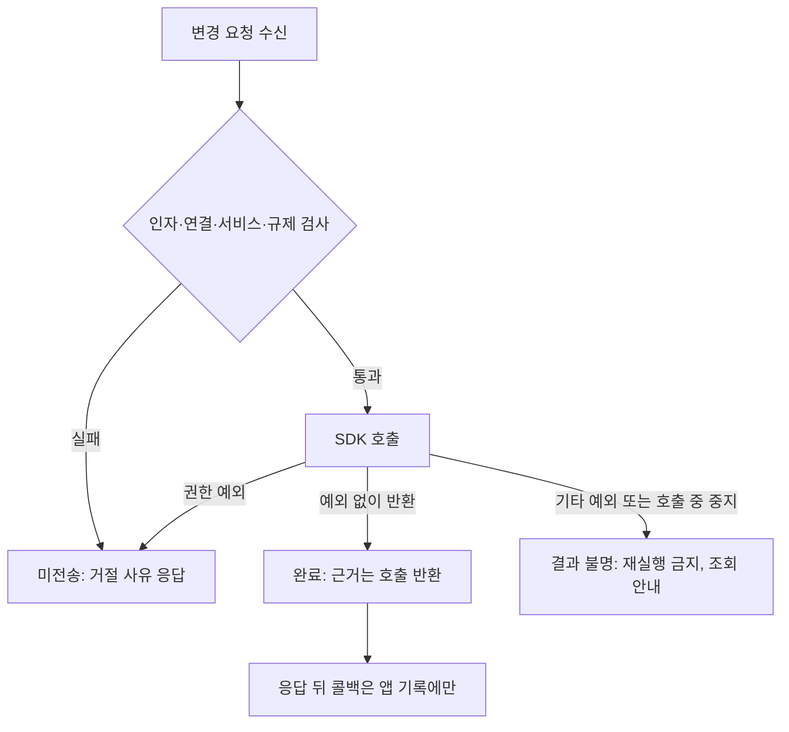

# 내비 요청·결과 공통 규칙 - Plan

## Goal Capsule

- **Objective:** 두 개발자가 같은 내비 규칙으로 COM-21(앱)과 COM-24(AI 도구)를 시작한다. 그 결과 AI가 승인 없이 순정 내비의 목적지와 경로를 바로 조작하고, 결과와 추정 도착 시각을 받는 첫 단계를 구현할 수 있다.
- **Means:** 차량 조회 계약(COM-16)과 같은 방식으로 내비 전용 규칙 문서, 카탈로그, 공용 fixture, Android·Node 검증기, ADR을 만든다. SDK 실행, 앱 구현, MCP 도구 등록은 이 작업에 포함하지 않는다.
- **Product authority:** 요구·우선순위의 원천은 Linear COM-11·COM-3과 요구사항 정의서다. 규칙의 원천은 저장소 `contracts/`다. 요구사항과 충돌하는 결정은 ADR-0006의 임시 예외로 기록하고, 요구사항 원문은 고치지 않는다.
- **Open blockers:** 계획 착수를 막는 항목은 없다. 병합은 상대 개발자의 합의가 있어야 한다. 합의 대상은 계약과 ADR, COM-9 규제 기준 완화(R7), `AGENTS.md` 예외 문구(R28)다.
- **Stop conditions:** 다음 경우 멈추고 사실과 제안을 나눠 보고한다.
  - 카탈로그의 도구가 NaviHelper 3.0.5 배포 클래스에 없다.
  - 같은 fixture에서 Android와 Node의 판정이 일치하지 않는다.
- **사람이 끝낼 일:** 상대 개발자 리뷰·승인, 병합 지시, 병합 후 Linear 정리 확인.

---

## Product Contract

### Summary

차량 조회 계약과 같은 구조로 내비 전용 계약을 만든다. NaviHelper 3.0.5 공개 API의 도구 16개에 대해 입력, 결과, 오류, 시간 값, 규제 차단 규칙을 문서와 테스트 사례로 고정한다. Android와 Node는 같은 사례로 검사한다.
변경은 승인 없이 SDK 호출이 끝나면 완료로 응답한다. 승인은 나중에 만들 신뢰 실행 경계가 맡는다.

### Problem Frame

COM-21과 COM-24는 내비 규칙이 없어 Backlog에 머물러 있다. 차량 조회는 COM-16 계약이 먼저 나온 뒤 COM-20·COM-23이 구현됐지만, 그 계약은 내비를 범위 밖으로 두고 변경 결과 처리와 목적지 없음 등을 COM-11로 넘겼다(`contracts/vehicle-read/CONTRACT.md`).

COM-8 실험에서 확인된 사실은 다음과 같다.
- 좌표만 준 목적지 설정은 재조회 좌표가 정확히 일치했다.
- 공식 샘플의 장소 ID 입력은 다른 장소로 설정됐다.
- 새 완료 콜백은 30초 안에 오지 않았고, 안내 중에도 `isRouting=false`였다.
- `requestRoute`부터 `onRouteStarted`까지 5.7~8.1초가 걸렸다.
- `remainTime`은 공식 초 단위이며 화면과 일치했다. Trip `eta`는 기준 시각이 없다.

남은 의문을 COM-34·35·36으로 분리했지만, 결과를 기다리면 11/7까지인 요구사항 일정(G2~G4)을 맞추기 어렵다.

요구사항은 승인 검증이 안 되면 변경 도구를 빼라고 정한다(FR-NAV-05). 하지만 신뢰할 수 있는 승인 수단이 아직 없다. 그래서 이번 단계는 승인 없이 조작하는 임시 규칙으로 진행하고, 충돌을 기록으로 남긴다.

### Key Decisions

- **승인 없이 바로 조작한다.** 승인/거부는 나중에 만들 신뢰 실행 경계가 맡는다. Governs R9, R10, R27. (session-settled: user-directed — chosen over 차량 앱 화면 승인과 조회 전용 축소: 이번 단계는 내비 조작을 먼저 가능하게 하고 승인은 경계에서 다룬다)
- **이번 작업은 COM-11만 한다.** 앱 구현과 도구 등록은 Scope Boundaries에 둔다. (session-settled: user-approved — chosen over COM-21·24까지 함께 구현: 규칙을 먼저 합의해 구현 재작업을 줄인다)
- **NaviHelper 공개 API의 도구 16개를 전부 넣는다.** Governs R1, R4. (session-settled: user-approved — chosen over 위치·최근 목적지·즐겨찾기 제외: 모든 도구를 노출한다는 결정을 따른다)
- **규제가 켜졌거나 정보를 잃었거나 값이 오래되면 막는다.** Governs R7. (session-settled: user-approved — chosen over 규제 검사 연기와 COM-9 기준 유지: 요구사항 FR-UI-04를 지키면서 조작도 가능하게 한다)
- **장소는 좌표와 주소로 정하고 장소 ID는 쓰지 않는다.** Governs R5, R6. (session-settled: user-directed — chosen over COM-34 실험 선행: 정확한 위치는 추후 지오코딩으로 해결한다)
- **`eta`를 초로 가정한다.** Governs R18. (session-settled: user-directed — chosen over COM-35 공식 확인 대기)
- **SDK 호출이 예외 없이 끝나면 완료로 본다.** Governs R11, R12. (session-settled: user-directed — chosen over 재조회 좌표 대조와 오차 허용 대조: 콜백과 `isRouting`은 판단에 쓰지 않는다)
- **호출이 끝나면 바로 응답한다.** Governs R11, R12. (session-settled: user-approved — chosen over 콜백 대기와 짧은 대기: 5초 목표에 유리하다)
- **차량 앱이 추정 도착 시각을 계산한다.** Governs R19. (session-settled: user-approved — chosen over AI 계산과 `remainTime`만 계산: AI의 시간대·덧셈 실수를 막는다)
- **설정 직후의 틀린 시간은 앱이 걸러 준다.** Governs R20. (session-settled: user-approved — chosen over 도구 설명으로 안내와 처리하지 않기: 경로 계산 중 이전 목적지의 시간이 새 목적지 값처럼 쓰이지 않게 한다)
- **실제 차량도 규칙상 허용한다.** Governs R9. (session-settled: user-directed — chosen over 에뮬레이터 한정: 신뢰 실행 경계가 생기면 앱 안에서 승인되지 않은 요청을 자동으로 거절한다고 명시한다)
- **되돌리기는 일정상 제외한다.** Governs R15, R26. (session-settled: user-approved — chosen over 미지원 확정과 목적지만 되돌리기 구현: 범위가 늘어난다)
- **문서 충돌은 임시 예외로 기록하고 요구사항 원문은 유지한다.** Governs R27, R28. (session-settled: user-approved — chosen over 요구사항 수정과 PR 본문만 기록)
- **Linear는 후속 이슈로 정리한다.** Governs R29, R30. (session-settled: user-approved — chosen over 세 이슈 Backlog 유지와 COM-11 결과만 기록)

### Actors

- A1. 외부 AI 클라이언트: ChatGPT·Claude. 도구를 호출하고 결과를 사용자에게 전한다.
- A2. Node MCP 서버: 도구 입력을 검사하고 차량 앱에 요청을 보낸다.
- A3. 차량 앱: 규제와 연결 상태를 검사하고 NaviHelper를 호출한다.
- A4. 순정 내비: 목적지·경로를 실제로 바꾸고 상태를 돌려준다.
- A5. 운전자: AI에게 요청한다. 이번 단계에서는 변경을 승인하지 않는다.
- A6. 두 개발자: 이 계약으로 COM-21·24를 구현하고 서로 리뷰한다.

### Requirements

**도구 범위**

- R1. 계약은 NaviHelper 3.0.5 공개 API로 아래 도구 16개를 정의한다.
- R2. 수명 주기 API(`initialize`·`release`·리스너), 화면 요청(`requestNavigationScreen`), 비공개 API(`getInternalApi`)는 제외하고 사유를 기록한다. 콘솔에만 있는 `findRoute`·`startRouteGuiding`은 Helper 3.0.5에 없다는 사실도 기록한다.
- R3. 도구는 차량 조회와 같이 에뮬레이터 실행 검증 뒤에만 AI에게 공개한다. 변경 도구는 공개 전에 실제 효과를 재조회나 화면으로 한 번 확인한다.
- R4. 위치·최근 목적지·즐겨찾기 도구의 설명은 값이 외부 AI로 전달된다고 알린다. 그 값은 로그와 호출 기록에 남기지 않는다.

| 구분 | 도구 | SDK | 현재 근거 |
| --- | --- | --- | --- |
| 조회 | 현재 목적지 | `getDestinationInfo` | sdk_emulator |
| 조회 | 경로 상태 | `getRouteStateInfo` | sdk_emulator |
| 조회 | 지정 지점 Trip | `requestTrip` | sdk_emulator |
| 조회 | 경유지 | `getWaypointInfo` | 미실행 |
| 조회 | 회전 안내 | `getTBTInfo` | 미실행 |
| 조회 | 현재 위치 | `getCurrentLocationInfo` | 미실행 |
| 조회 | 최근 목적지 | `getRecentDestinationInfo` | 미실행 |
| 조회 | 즐겨찾기 | `getBookmarkInfo` | 미실행 |
| 조회 | 충전 사업자 | `getChargerOperatorInfo` | 미실행 |
| 변경 | 목적지 설정 | `requestRoute` | sdk_emulator |
| 변경 | 안내 취소 | `cancelRoute` | sdk_emulator |
| 변경 | 경유지 포함 경로 설정 | `requestRouteWithWaypoints` | 미실행 |
| 변경 | 경유지 추가 | `addWaypoint` | 미실행 |
| 변경 | 경유지 삭제 | `removeWaypoint` | 미실행 |
| 변경 | 경로 옵션 변경 | `changeRouteOption` | 미실행 |
| 변경 | 재탐색 | `requestReRoute` | 미실행 |

**입력**

- R5. 목적지와 경유지는 위도, 경도, 표시명, 주소로 받는다. 장소 ID 입력은 받지 않으며, 차량 앱이 SDK의 장소 ID를 비운 값으로 채운다.
- R6. 변경 응답은 좌표가 AI가 보낸 값이며 앱이 정확성을 보장하지 않는다고 알린다.

**실행 전 검사**

- R7. 변경은 다음 경우 SDK를 호출하지 않고 규제 차단으로 거절한다: 최신 Car UX 정보가 규제 활성이거나, 정보를 잃었거나, 값이 오래됐을 때. `DO=false`·`flags=0`이면 실행한다. 응답에는 '정차 확인'이 아니라 '규제 미활성'으로 표기한다.
- R8. 다음 경우에도 SDK를 호출하지 않고 미전송으로 거절한다: 연결 중지 상태, 내비 서비스 연결 전, 인자 오류, 권한 오류.
- R9. 규칙은 실제 차량에서의 변경을 막지 않는다. 신뢰 실행 경계가 생기면 앱 안에서 승인되지 않은 변경 요청을 자동으로 거절한다고 명시한다.
- R10. 신뢰 실행 경계의 승인 검사가 들어갈 위치는 SDK 호출 직전 한 곳으로 정해 둔다.

**변경 결과**

- R11. 변경은 SDK 호출이 예외 없이 반환되면 바로 '완료'로 응답한다. 응답에는 판단 근거가 호출 반환이고 실제 반영은 확인하지 않았다는 사실을 담는다.
- R12. 콜백과 `isRouting`은 완료 판단에 쓰지 않는다. 응답 뒤에 온 `onError` 등은 차량 앱 기록에만 남기고, 이미 보낸 응답을 바꾸지 않는다.
- R13. 다음 경우는 '결과 불명'으로 답한다: 권한 외 예외, 호출 중 연결 중지, 요청을 보낸 뒤 응답을 잃음. 결과 불명이면 자동으로 다시 실행하지 말고 조회 도구로 확인하라고 안내한다. Node가 연결하지 못해 보내지 않은 요청은 미전송이다.
- R14. 어느 계층도 자동으로 다시 실행하지 않는다. 같은 요청 ID가 다시 오면 실행하지 않고 중복 요청으로 답한다.
- R15. 변경 응답에는 변경 식별자와 '되돌리기 불가, 이유: 일정상 제외'를 담는다. 조회 응답에는 넣지 않는다.
- R16. 내비 요청은 한 번에 하나만 처리하고, 처리 중에 들어온 요청은 BUSY로 거절한다. 내비 요청과 차량 조회는 서로를 막지 않는다.

**조회와 시간**

- R17. 조회는 다음 상태를 구분한다: 목적지 없음, 필드 부재, 권한 오류, 서비스 불가, 무응답. 빈 이름과 좌표 (0, 0)이면 목적지 없음이고 시간·거리는 null이다. 0초를 '곧 도착'으로 보내지 않는다.
- R18. `remainTime`과 Trip `eta`는 원시 초와 수신 시각으로 보낸다. `eta`는 '초로 가정'이라고 표시한다. SDK가 주지 않는 측정 시각과 절대 ETA는 보내지 않는다.
- R19. 차량 앱은 두 시간 값 각각으로 추정 도착 시각을 계산해 보낸다. 계산은 수신 시각에 초를 더하는 방식이며, 시간대를 포함하고 '추정'이라고 표시한다. 값이 없거나 음수면 추정 도착 시각은 null이다.
- R20. 차량 앱은 마지막으로 설정한 목적지 좌표를 기억한다. 조회한 목적지 좌표가 그와 다르면 불일치로 표시하고 추정 도착 시각을 null로 보낸다.
- R21. 기억한 좌표는 메모리에만 두며, 앱을 재시작하면 남지 않는다.

**계약 산출물과 검증**

- R22. 규칙 문서, 카탈로그, fixture는 Android와 Node가 같은 파일로 검사한다. 한쪽만 바꾸면 CI가 실패해야 한다.
- R23. fixture 사례마다 근거를 `mock`, `source_only`, `sdk_emulator` 중 하나로 표시한다. COM-8 실측값은 위치를 제거한 값만 쓴다.
- R24. fixture는 AE1~AE8과 다음 사례를 포함한다: 부분 미지원, 권한 오류, 무응답, 늦은 응답, BUSY, 에뮬레이터 아님, 장소 ID 입력 거부, 되돌리기 불가.
- R25. 카탈로그의 도구와 SDK 메서드를 NaviHelper 3.0.5 배포 클래스와 대조하는 테스트가 있다.
- R26. 되돌리기를 나중에 구현할 수 있도록 다음을 기록한다: 보존 가능한 범위(좌표, 이름, 주소, 장소 ID), 보장할 수 없는 범위(경유지, 경로 옵션, 과거 경로), 충돌 검사 조건, 실행한 적이 없다는 사실.

**문서와 Linear**

- R27. ADR-0006에 임시 결정을 기록한다: 승인 없는 내비 변경, 호출 반환 기준의 완료 판단, COM-9 규제 기준 완화, 신뢰 실행 경계의 도입 조건.
- R28. 다음 문서에 ADR-0006을 가리키는 예외 문구를 추가한다: 루트 `AGENTS.md`의 승인 규칙, `docs/architecture/scenarios/appointment-departure.md`. 예외는 내비 변경에만 적용하며, 차량 변경·메시지 전송·네트워크 공개 규칙은 그대로 둔다. 요구사항 FR-NAV-02·05·06은 원문을 유지하고 미충족 상태로 기록한다.
- R29. 병합 후 Linear를 정리한다.
  - 새 이슈 2개를 만든다: 신뢰 실행 경계(승인 결합, 실차 전제), 지오코딩(COM-34의 문자열 변환 조사 이관).
  - COM-34·36은 이유를 남기고 Canceled로 닫는다. COM-35는 Backlog로 둔다.
  - COM-21·24·27은 승인 결합과 재조회 확인 항목을 옮기고, 경유지 도구를 범위에 넣은 뒤 Todo로 옮긴다.
- R30. COM-11의 승인 관련 수용 기준은 신뢰 실행 경계 이슈로 이관한다고 문구를 고친 뒤 COM-11을 완료 처리한다.

### Key Flows

- F1. 목적지 설정
  - **Trigger:** 운전자가 AI에게 목적지 변경을 요청한다.
  - **Actors:** A1, A2, A3, A4, A5
  - **Steps:** AI가 좌표·이름·주소로 목적지 설정 도구를 호출한다. MCP 서버가 입력을 검사해 차량 앱에 보낸다. 차량 앱이 연결·서비스·규제를 검사하고 `requestRoute`를 호출한다. 호출이 반환되면 차량 앱이 '완료'와 변경 식별자를 돌려준다. AI는 실제 반영이 확인되지 않았다는 안내와 함께 결과를 전한다.
  - **Outcome:** 응답 뒤의 내비 오류는 차량 앱 기록에만 남는다.
  - **Covered by:** R5~R13, R15

- F2. 설정 후 도착 시각 조회
  - **Trigger:** AI가 설정 직후 도착 시각을 조회한다.
  - **Actors:** A1, A2, A3, A4
  - **Steps:** 차량 앱이 현재 목적지를 읽는다. 목적지가 마지막 설정과 같으면 남은 시간과 추정 도착 시각을 보낸다. 다르면 불일치로 표시하고 추정 도착 시각을 비워 보낸다.
  - **Covered by:** R17~R20

### Acceptance Examples

- AE1. **Covers R11, R15.** **Given** 규제 미활성이고 내비 서비스가 연결된 상태다. **When** AI가 목적지 설정을 호출하고 SDK 호출이 예외 없이 반환된다. **Then** '완료', 판단 근거(호출 반환), 변경 식별자, 되돌리기 불가를 즉시 응답한다.
- AE2. **Covers R7.** **Given** Car UX가 규제 활성이거나 정보를 잃었다. **When** AI가 변경을 호출한다. **Then** SDK를 호출하지 않고 규제 차단으로 거절한다.
- AE3. **Covers R20.** **Given** 회사로 안내 중에 AI가 강남역으로 설정해 '완료'를 받았다. **When** 경로 계산 전에 조회한 목적지가 회사로 나온다. **Then** 불일치를 표시하고 추정 도착 시각을 null로 보낸다.
- AE4. **Covers R13.** **Given** SDK 호출이 진행 중이다. **When** 사용자가 연결을 중지한다. **Then** 결과 불명으로 답하고 자동으로 다시 실행하지 않는다.
- AE5. **Covers R13.** **Given** Node가 차량 앱에 요청을 보냈다. **When** 응답을 받지 못한다. **Then** 결과 불명으로 답한다. 연결 자체에 실패했으면 미전송으로 답한다.
- AE6. **Covers R14.** **When** 이미 처리한 요청 ID가 다시 온다. **Then** 실행하지 않고 중복 요청으로 답한다.
- AE7. **Covers R17.** **Given** 내비에 목적지가 없다. **When** 현재 목적지를 조회한다. **Then** 목적지 없음으로 답하고 시간·거리·추정 도착 시각은 null이다.
- AE8. **Covers R12.** **Given** '완료' 응답을 이미 보냈다. **When** 그 뒤 `onError`가 온다. **Then** 차량 앱 기록에만 남기고 응답은 바꾸지 않는다.

### Success Criteria

- 같은 fixture에서 Android와 Node가 같은 판정을 내고, 한쪽 판정을 바꾸면 CI가 실패한다.
- 이번 작업 뒤에도 AI에게 보이는 도구 목록은 기존 차량 조회 20개 그대로다.
- COM-21·24 담당자가 이 계약만 보고 입력, 결과, 오류, 시간 값을 새로 정하지 않고 구현을 시작할 수 있다.
- 상대 개발자가 PR에서 계약과 ADR-0006에 합의한다.

### Scope Boundaries

**이번에 하지 않는 것**
- 신뢰 실행 경계(승인 결합, 거절·재사용 차단)
- 지오코딩과 장소 문자열 변환
- 실제 차량 인식. 지금 앱은 실차를 `APP_NOT_READY`로 거절한다.
- 되돌리기 구현
- COM-21·24·27의 SDK 호출, 도구 등록, E2E
- 규제 활성 전환 관찰과 `requestRoute` 때 내비 팝업 여부 확인(COM-21·27 첫 실행에서 확인)

**1차 범위 밖**
- Gleo 연동, 차량 직접 제어

### Dependencies / Assumptions

- `eta`가 초라는 것은 가정이다. 공식 확인은 COM-35에 남는다.
- 규칙상 실차를 허용하지만, 실차 인식 기능을 신뢰 실행 경계보다 먼저 넣으면 운전 중 승인 없이 안내가 바뀔 수 있다.
- '완료'여도 다른 장소로 설정될 수 있다. 좌표가 조금만 달라도 R20 때문에 추정 도착 시각이 계속 비어 약속 지연 판단을 못 할 수 있다.
- 규제 상태를 읽는 코드는 병합되지 않은 PR #10에 있다.

### Outstanding Questions

**Resolve Before Planning**
- 없음.

**Deferred to Planning**
- 규제 값이 '오래됐다'고 볼 시간(PR #10의 3초 검토).
- 내비 서비스 연결 완료를 판단할 SDK 경로. 연결 콜백 overload는 미실험이다.
- Bridge 경로와 요청·응답 모양.
- 조회 timeout 뒤 늦은 콜백이 다음 요청에 섞이지 않게 하는 방법(SDK 콜백에 요청 식별자가 없음).
- 응답 뒤 콜백을 어느 변경 기록에 붙일지.
- 도구별 권한과 입력 필드(경유지 순번, 경로 옵션 값).

### Sources / Research

- [SDK 지원 기능표](https://linear.app/wonsub/document/sdk-지원-기능표-87b2fb93edc2): COM-8 실측과 채택 판단
- [요구사항 정의서](https://linear.app/wonsub/document/요구사항-정의서-1b7e6fcd5721): FR-NAV-01~08, FR-UI-04, FR-DAT-01~05, 5.2·5.3, AT-05·06·08~11
- `contracts/vehicle-read/CONTRACT.md`, `docs/decisions/0004-vehicle-read-contract.md`: 따라갈 계약 구조와 COM-11로 넘긴 세 항목
- `app/src/main/java/com/example/pleos_pa/vehicle/DeviceIdentity.kt`: 실차를 `real_vehicle`로 보고하지 않는 현재 동작
- `mcp/src/server.ts`: `adopted` 도구만 등록하는 규칙
- `app/src/test/java/com/example/pleos_pa/contract/ContractFixtures.kt`: fixture 폴더를 `contracts/vehicle-read`로 고정
- NaviHelper 3.0.5·navi-data 3.0.4 배포 클래스: 공개 메서드와 데이터 모델 확인
- [NaviHelper 목적지 문서](https://document.pleos.ai/en/docs/pleos-only/connect-sdk-pleos/NaviHelper/destinations): 호출 성공은 경로 탐색 완료가 아니라는 설명, 확인 팝업 언급 없음
